

  

  
 &nbsp;  &nbsp; 

<a href="https://github.com/denisans/denisans/blob/main/details/product-and-delivery-skills.md"></a>
<a href="https://github.com/denisans?tab=repositories"></a>
<a href="https://github.com/denisans/denisans/blob/main/details/product-thinking.md"></a>
<a href="https://github.com/denisans/denisans/blob/main/details/understand-the-problem.md"></a>

<table>
  <tr>
    <td width="33%" valign="top"><b>Project Management</b> Plan, align, and deliver with clear priorities.</td>
    <td width="33%" valign="top"><b>Product Thinking</b> Frame the problem and decide what is worth building.</td>
    <td width="33%" valign="top"><b>Business Analysis</b> Turn business needs into clear, testable requirements.</td>
  </tr>
</table>

## What I bring

<b>Product thinking</b> &nbsp;Problem framing, prioritization, and decision-making &nbsp;

<b>Engineering mindset</b> &nbsp;Building, iterating, and improving with intention &nbsp;

<b>Collaboration</b> &nbsp;Aligning teams around outcomes and execution &nbsp;

<b>Delivery focus</b> &nbsp;Turning ideas into usable product progress &nbsp;

## How I work

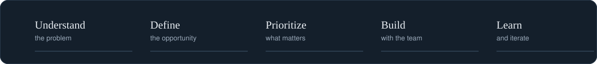

<b>01 &nbsp;Understand the problem</b> &nbsp;Context, users, and constraints first &nbsp;

<b>02 &nbsp;Define the opportunity</b> &nbsp;Turn the problem into a clear direction &nbsp;

<b>03 &nbsp;Prioritize</b> &nbsp;Decide what to do now, next, and not at all &nbsp;

<b>04 &nbsp;Build</b> &nbsp;Deliver in small, visible steps with the team &nbsp;

<b>05 &nbsp;Learn</b> &nbsp;Review results, feed them back, and iterate &nbsp;

## Repositories

<table>
  <tr>
    <td width="50%" valign="top">
      <a href="https://github.com/denisans/denisans/blob/main/details/crownsky.md"></a>
      
 &nbsp; 

    </td>
    <td width="50%" valign="top">
      <a href="https://github.com/denisans/denisans/blob/main/details/cafe-management.md"></a>
      
 &nbsp; 

    </td>
  </tr>
  <tr>
    <td width="50%" valign="top">
      <a href="https://github.com/denisans/denisans/blob/main/details/qa-tracker.md"></a>
      
 &nbsp; 

    </td>
    <td width="50%" valign="top">
      <a href="https://github.com/denisans/denisans/blob/main/details/portofolio.md"></a>
      
 &nbsp; 

    </td>
  </tr>
  <tr>
    <td colspan="2" align="center">
      <a href="https://github.com/denisans/denisans/blob/main/details/denisans.md"></a>
      
 &nbsp; 

    </td>
  </tr>
</table>

## Skills and tools


<b>Product and delivery skills</b> &nbsp;Product thinking, prioritization, requirements, delivery management &nbsp;

<b>Quality and collaboration</b> &nbsp;QA workflow, stakeholder alignment &nbsp;

<b>Tech and tools</b> &nbsp;HTML5, PHP, Git, GitHub &nbsp;

## Let's connect

 &nbsp;  &nbsp; 

 

