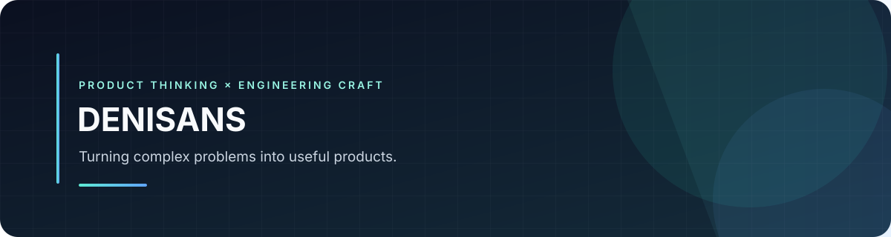

  

<a href="https://github.com/denisans">GitHub</a> · Product Management · Software Engineering · Product Building

---

## Hey, I'm Denisans 👋

I’m a product-minded PM and engineer who enjoys turning messy problems into clear product direction and practical software.

I work best at the intersection of **user needs**, **business goals**, and **technical execution** — building products that are useful, thoughtful, and easy to improve.

### What I bring

- Product thinking: problem framing, prioritization, and decision-making
- Engineering mindset: building, iterating, and improving with intention
- Collaboration: aligning teams around outcomes and execution
- Delivery focus: turning ideas into usable product progress

### Featured work

- [QA Tracker](https://github.com/denisans/qa-tracker) — A project focused on improving QA tracking and workflows.
- [Cafe Management](https://github.com/denisans/Cafe_Management) — A cafe operations system project.
- [Hotel Website](https://github.com/denisans/portofolio.github.io) — A hospitality-focused website project.

### My working style

`Understand the problem` → `Define the opportunity` → `Prioritize` → `Build` → `Learn`

I care about clarity, execution, and continuous iteration.

### Let’s connect

[GitHub](https://github.com/denisans) • [LinkedIn](https://www.linkedin.com/in/your-profile) • [Email](mailto:your.email@example.com)

*Building useful products with clarity, care, and momentum.*

