

  

   

  
  
  

 

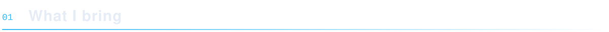

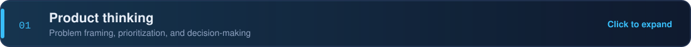

Every piece of work starts from the user and business problem, not the solution. I frame the problem, size the opportunity, and decide what to build, and just as importantly what not to build.

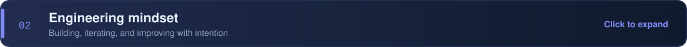

I build, iterate, and improve with intention. The projects on this profile (QA Tracker, Cafe Management, Hotel Website) are practical examples of turning an idea into something people can use.

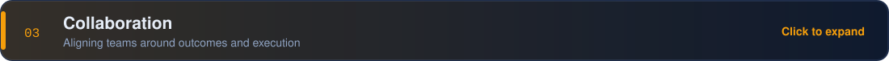

I align teams around outcomes and execution: shared goals, clear priorities, and visible progress, so stakeholders and the delivery team stay on the same page.

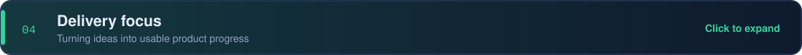

I focus on turning ideas into usable product progress: small steps, quick feedback, and continuous improvement rather than big-bang releases.

 

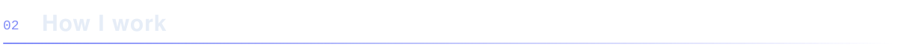

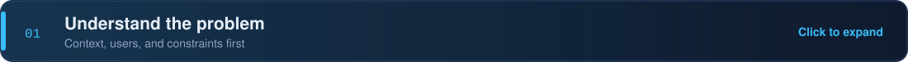

Talk to users and stakeholders, gather context, and clarify constraints before proposing anything.

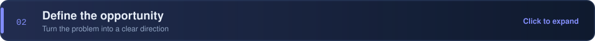

Turn what I learned into a clear problem statement, goals, and a direction the team can rally around.

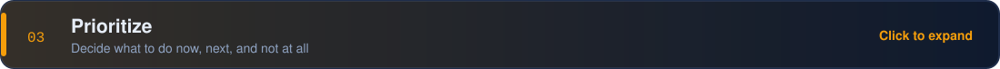

Weigh value, effort, and risk to decide what happens now, what comes next, and what is left out.

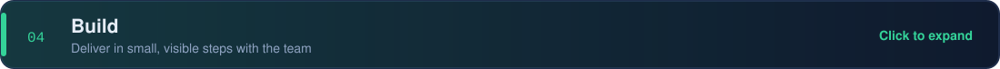

Work with the team to deliver in small, visible increments and keep requirements and progress clear.

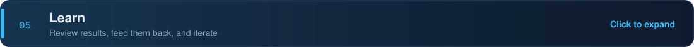

Review results, capture feedback, and feed it back into the next iteration.

 

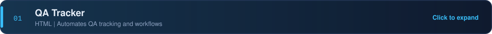

Automates QA tracking to improve QA workflows and make test reporting and fix follow-up faster and more transparent.

**Tech:** HTML  
**Repository:** [denisans/qa-tracker](https://github.com/denisans/qa-tracker)

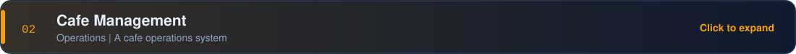

A cafe operations system for managing day-to-day business flow.

**Tech:** Operations  
**Repository:** [denisans/Cafe_Management](https://github.com/denisans/Cafe_Management)

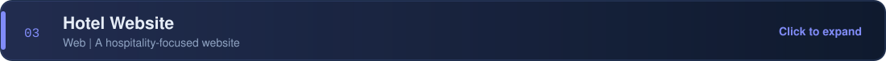

A hospitality-focused website project built as a product and web delivery exercise.

**Tech:** Web  
**Repository:** [denisans/portofolio.github.io](https://github.com/denisans/portofolio.github.io)

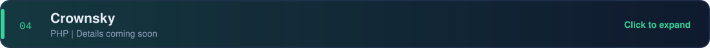

A PHP project. A fuller description is coming soon.

**Tech:** PHP  
**Repository:** [denisans/Crownsky](https://github.com/denisans/Crownsky)

 


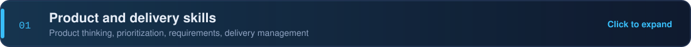

- Product thinking
- Prioritization
- Requirements
- Delivery management

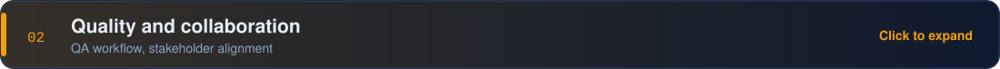

- QA workflow
- Stakeholder alignment

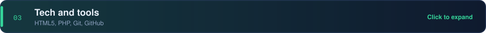

- HTML5
- PHP
- Git and GitHub

 

  
  

 

