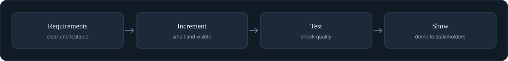

[Back to profile](https://github.com/denisans)



*About 6 min read*

## Overview

Work with the team to deliver in small, visible increments and keep requirements and progress clear.



## On this page

- [What "build" means for a product person](#what-build-means-for-a-product-person)
- [Part 1. Requirements that people can build and test](#part-1-requirements-that-people-can-build-and-test)
- [Part 2. Deliver in increments](#part-2-deliver-in-increments)
- [Part 3. Test as you go](#part-3-test-as-you-go)
- [Template: a requirement card](#template-a-requirement-card)
- [Common mistakes](#common-mistakes)
- [How it shows up in my work](#how-it-shows-up-in-my-work)
- [Sources](#sources)

## In short

**Write clear requirements.** Each item has a purpose, acceptance criteria, and an owner.

**Deliver in increments.** Work is shown to stakeholders as it grows, not only at the end.

**Test as we go.** Quality checks sit inside the flow, as in the qa-tracker project.

**Keep progress visible.** A single board and a regular update show where things stand.

## What "build" means for a product person

In this step the team turns the chosen direction into working software. My role is not to write the code but to make sure that **everyone knows what is being built, why, and how we will recognize that it is right**. That comes down to three things: clear requirements, small visible increments, and testing built into the flow.

## Part 1. Requirements that people can build and test

### Business and product requirements

Two documents are often confused:

| | Business requirements (BRD) | Product requirements (PRD) |
|---|---|---|
| Answers | **Why** does the initiative exist? | **What** should the product do? |
| Audience | Sponsors and decision makers | Product, design, engineering, QA |
| Contains | Business problem, goals, scope, benefits | User problems, requirements, acceptance criteria, success metrics |
| Changes | Rarely | Often, as a living document |

They are sequential rather than competing: the business case explains why, the product document explains what. Writing the second without the first risks a precisely specified answer to the wrong question.

### Functional and non-functional requirements

- **Functional:** what the system *does*. "A guest can search rooms by date."
- **Non-functional:** how well it must do it: speed, security, availability, accessibility. "Search results load in under three seconds." These are easy to forget and expensive to add late.

### User stories

A user story states a need from the user's side in one sentence:

```text
As a [type of user], I want [a capability], so that [a benefit].
```

Example: *As a hotel manager, I want to see this week's bookings on one page, so that I can plan staffing without asking the front desk.*

The story is a **starting point for a conversation**, not a contract. The details are worked out with the team.

### Checking a story with INVEST

Bill Wake proposed six qualities of a good story. Use them as a checklist:

| Letter | Quality | The question |
|---|---|---|
| **I** | Independent | Can it be built and delivered without waiting for another story? |
| **N** | Negotiable | Is there room to discuss the details? |
| **V** | Valuable | Does a user or the business benefit from it on its own? |
| **E** | Estimable | Is it clear enough to estimate? |
| **S** | Small | Can it be finished within one iteration? |
| **T** | Testable | Can we say for certain whether it works? |

Small and Valuable pull against each other. If you slice a story so thin that it delivers no value alone, you have gone too far.

### Acceptance criteria

Acceptance criteria say how the team will know the story is done. A clear format is **Given, When, Then**:

```text
Given  I am a hotel manager and I am signed in
When   I open the weekly bookings page
Then   I see every booking for the current week, grouped by day
And    each booking shows the guest name, room, and check-in date

Given  there are no bookings this week
When   I open the weekly bookings page
Then   I see a message saying there are no bookings, not a blank page
```

Always include the **empty case** and at least one **failure case**. Most defects live there.

### A traceability table

A small table that links each requirement to its story and to the test that proves it. When a stakeholder asks "did you include the thing I asked for?", the answer is one row.

| Requirement | Story | Acceptance test | Status |
|---|---|---|---|
| R1. Managers see weekly bookings | S-12 | AT-12a, AT-12b | Built |
| R2. Export bookings to PDF | S-15 | AT-15a | Planned |

## Part 2. Deliver in increments

Show working software early and often. A rhythm that works for small teams:

1. Agree the next slice and its acceptance criteria.
2. Build it, with a second person reviewing.
3. Test it against the criteria.
4. **Show it to the stakeholder**, in the real product, not in slides.
5. Record the feedback and adjust the next slice.

A working demo changes the conversation. People who could not describe what they wanted can tell immediately what is wrong.

## Part 3. Test as you go

Quality is cheaper when it is part of the flow than when it is a phase at the end.

- **Review** requirements before building: ask "how would I test this?" If nobody can answer, the requirement is not ready.
- **Test** each increment against its acceptance criteria, including empty and failure cases.
- **Record** every defect in one list, with steps to reproduce, expected result, and actual result.
- **Retest** after a fix, and let QA decide when the item is closed.

### A bug report that gets fixed

```text
Title:      Checkout button does nothing on mobile
Severity:   High    (blocks a core task)
Steps:      1. Open the site on a phone
            2. Add a room to the booking
            3. Tap "Pay"
Expected:   The payment page opens
Actual:     Nothing happens, no error message
Evidence:   Screenshot, device and browser
```

A report that another person can reproduce in one minute is far more likely to be fixed the same day.

## Template: a requirement card

```text
ID:           R-07
Title:        Weekly bookings page
Why:          Managers plan staffing without asking the front desk
Story:        As a hotel manager, I want ..., so that ...
Acceptance:   (Given / When / Then, including empty and failure cases)
Non-functional: loads in under 3 seconds with 500 bookings
Out of scope: exporting to PDF (see R-09)
Owner:        (who decides if it is right)
Status:       Draft | Ready | In build | In test | Done
```

## Common mistakes

- **Requirements that describe the solution** ("add a dropdown") instead of the need.
- **Acceptance criteria that cannot be tested** ("easy to use").
- **Forgetting non-functional requirements** until the system is slow or insecure.
- **Stories too big to finish in an iteration.**
- **Demos only at the end.**
- **A bug list spread across chat messages**, so nobody knows the true state.

## How it shows up in my work

The **qa-tracker** project is the practical example: it keeps one shared list of findings, each with steps, expected and actual results, severity, and status, and its automatic checks run on every push. The same habit applies to **Crownsky** and **Cafe_Management**, which are both described through the screens and flows they actually contain.

## What it produces

- Requirements with acceptance criteria
- Working increments
- A progress view for stakeholders

## Where it shows up

- [qa-tracker](https://github.com/denisans/denisans/blob/main/details/qa-tracker.md)

## Sources

- [User stories and the INVEST mnemonic (Martin Fowler)](https://www.martinfowler.com/bliki/UserStory.html)
- [BRD compared with PRD (Plane)](https://plane.so/blog/brd-vs-prd-whats-the-difference-and-when-should-teams-use-each)
- [Writing and testing with pytest, if you want to see how a developer tests](https://learn.microsoft.com/en-us/training/modules/test-python-with-pytest/2-pytest-basics)

---

[Back to profile](https://github.com/denisans)
