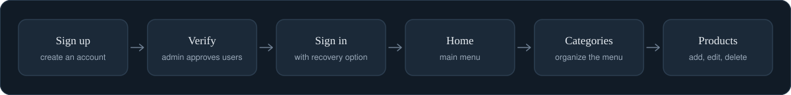
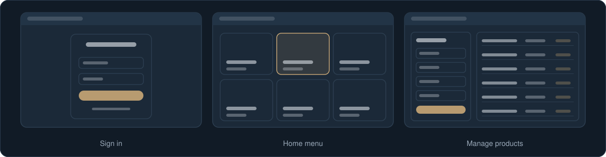

[Back to profile](https://github.com/denisans)

**Repository:** [denisans/Cafe_Management](https://github.com/denisans/Cafe_Management) &nbsp;|&nbsp; **Stack:** Java, MySQL

## Overview

Cafe_Management is a desktop application built with Java in NetBeans (Swing) and a MySQL database. It covers user accounts with administrator approval, password recovery, and the management of menu categories and products. The code is organized in three layers: screens, data access, and models.

## User and menu flow

From creating an account to maintaining the menu.

## Screens

Simplified sketches of the main screens.

## What is inside

| Layer | What it covers | Main files |
|---|---|---|
| **Screens** | Sign up, sign in, password recovery, home, user verification, categories, products | `Login`, `Signup`, `ForgotPassword`, `Home`, `VerifyUsers`, `ManageCategory`, `AddNewProduct`, `ViewEditDeleteProduct` |
| **Data access** | Database connection and operations for users, categories, and products | `ConnectionProvider`, `UserDao`, `CategoryDao`, `ProductDao` |
| **Models** | The data the screens and database exchange | `User`, `Category`, `Product` |

## How it works

- New users are verified by an administrator before they can sign in.
- Products belong to categories, so the menu stays organized as it grows.
- Keeping screens, data access, and models separate makes each part easier to change on its own.

## Technology

- Java (NetBeans, Swing)
- MySQL with the MySQL Connector/J driver

## Status and next steps

**Status:** The project source is stored as archives in the repository. The test archive covers accounts, categories, and products.

- Unpack the source into the repository so it can be browsed on GitHub.
- Add order placement and billing screens, which appear in the home menu design.
- Add a README with setup steps and screenshots.

---

[Back to profile](https://github.com/denisans) &nbsp;|&nbsp; [Open the repository](https://github.com/denisans/Cafe_Management)
