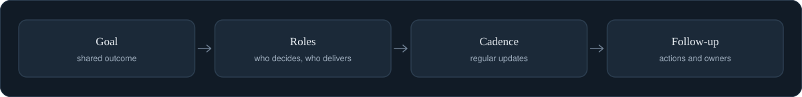

[Back to profile](https://github.com/denisans)



*About 5 min read*

## Overview

I align teams around outcomes and execution: shared goals, clear priorities, and visible progress, so stakeholders and the delivery team stay on the same page.



## On this page

- [What collaboration means in delivery work](#what-collaboration-means-in-delivery-work)
- [1. A shared goal](#1-a-shared-goal)
- [2. Clear ownership with RACI](#2-clear-ownership-with-raci)
- [3. A steady rhythm](#3-a-steady-rhythm)
- [4. Resolving disagreement early](#4-resolving-disagreement-early)
- [Stakeholder map](#stakeholder-map)
- [Run a short retrospective](#run-a-short-retrospective)
- [Common mistakes](#common-mistakes)
- [How it shows up in my work](#how-it-shows-up-in-my-work)
- [Sources](#sources)

## In short

**Share the goal.** Everyone should be able to say what the team is trying to achieve and why.

**Make priorities visible.** A single, current list of priorities prevents competing requests.

**Keep communication regular.** Short, predictable updates replace surprises.

**Resolve conflicts early.** When stakeholders disagree, I bring the options and trade-offs to one conversation.

## What collaboration means in delivery work

Collaboration is not being friendly. It is making sure that a group of people with different goals, vocabularies, and deadlines **move in the same direction and know who does what**. Most delivery problems that look like "communication problems" are really one of four things: no shared goal, unclear ownership, no steady rhythm, or decisions that were never recorded.

This page covers a practical tool for each of those four.

## 1. A shared goal

If you ask five people on a team what the project is for and get five answers, the team is not aligned, however well they get along.

**Write the goal as one sentence that includes a result, not a task.**

| Task-style (weak) | Outcome-style (strong) |
|---|---|
| "Build the admin report page" | "Hotel managers can see the week's bookings in under a minute, without asking anyone" |
| "Fix the QA backlog" | "No Critical finding stays open for more than two working days" |

Then test it. Ask each person to write the goal from memory. If the answers differ, discuss until they match. That conversation is the real deliverable.

## 2. Clear ownership with RACI

A **RACI matrix** answers "who does what" for each task or decision. The four letters:

- **R, Responsible.** Does the work. There can be several.
- **A, Accountable.** Owns the result and approves it. There should be **exactly one** per item. This is the rule that matters most.
- **C, Consulted.** Gives input before the work is final. Two-way conversation.
- **I, Informed.** Is told the outcome. One-way communication.

### Example (illustrative)

| Item | Product (PM) | Developer | QA | Stakeholder |
|---|---|---|---|---|
| Write the requirement | A, R | C | C | C |
| Build the feature | C | A, R | I | I |
| Test and verify the fix | I | C | A, R | I |
| Approve the release | R | C | C | A |

### Rules of thumb

1. Every row has at least one **R**.
2. Every row has exactly one **A**. If two people are accountable, nobody is.
3. Do not make everyone **C**. Too many consulted people slow decisions down.
4. Agree on the matrix *before* the work starts, and update it when scope changes.

## 3. A steady rhythm

Surprise is the enemy of trust. A short, predictable update removes most of it. Stakeholders who always know the status rarely need to ask for it.

### A weekly update template

```text
Status: Green / Amber / Red   (one word, with the reason)
Done this week:      (2 to 4 outcomes, not activities)
Next week:           (2 to 4 items)
Risks and blockers:  (what, who owns it, what is the next step)
Decisions needed:    (what, from whom, by when)
```

The last line is the most valuable. It turns an update from a report into a request, and it gives busy people one specific thing to act on.

### Meetings

- Every meeting has a purpose that is either *decide*, *align*, or *solve*. A meeting that is only *inform* is usually better as a written update.
- Share the agenda before, and the decisions and action owners after, in writing.

## 4. Resolving disagreement early

When two stakeholders want different things, the worst response is to give each a private promise. The better pattern:

1. **Write down each position** and the need behind it, in neutral words.
2. **Frame two or three options**, each with its benefit and its cost.
3. **Put the options in front of the decision owner**, with a recommendation and the reason.
4. **Record the decision** and tell everyone who was affected.

People can accept a decision they disagree with when they can see that their concern was heard, the options were fair, and the owner decided openly.

## Stakeholder map

Not every stakeholder needs the same attention. A simple grid helps decide how much effort each deserves.

| | Low interest | High interest |
|---|---|---|
| **High influence** | Keep satisfied: brief, targeted updates | Manage closely: involve in decisions |
| **Low influence** | Monitor: minimal effort | Keep informed: regular summary |

## Run a short retrospective

Collaboration improves only when the team looks at how it works. A retrospective is a short, regular meeting for exactly that. A simple format is **Start, Stop, Continue**: what should we start doing, stop doing, and keep doing? Limit the output to one to three actions, each with an owner. An action such as "improve communication" is too vague to do. "Post a status update every Thursday by noon" can be done.

## Common mistakes

- **Two accountable owners** for one decision.
- **Updates that list activities** ("worked on the login page") instead of outcomes and decisions.
- **Private promises** to different stakeholders that later collide.
- **Silent disagreement.** A quiet team is not always an aligned one.
- **Retrospectives with no actions**, or with ten actions and no owners.

## How it shows up in my work

The ownership rule is built into the **qa-tracker** project: findings are recorded in one shared list, the developer marks a fix, and **QA, not the tool and not the author of the fix, decides when a finding is closed after a retest.** That single rule is a RACI decision written into the workflow.

## What it produces

- A shared goal and a clear list of priorities
- A regular status update for stakeholders
- A record of decisions and the owner of each action

## Sources

- [The RACI matrix and its rules (Mind Tools)](https://www.mindtools.com/agn584l/the-raci-matrix)
- [RACI Matrix guide (ProjectSmart)](https://www.projectsmart.co.uk/tools/raci-matrix.php)
- [How to run a sprint retrospective](https://project-management.com/sprint-retrospective/)
- [Making retrospectives less boring (Agile Pain Relief)](https://agilepainrelief.com/blog/agile-retrospectives/)

---

[Back to profile](https://github.com/denisans)
