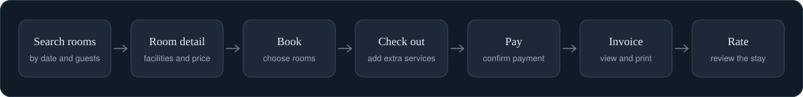
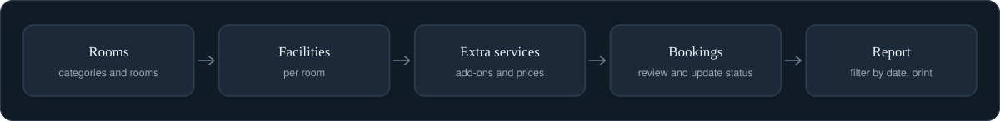
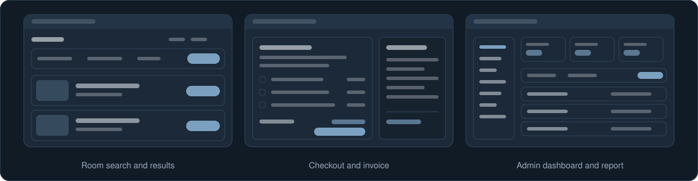

[Back to profile](https://github.com/denisans)

**Repository:** [denisans/Crownsky](https://github.com/denisans/Crownsky) &nbsp;|&nbsp; **Stack:** PHP, MySQL

## Overview

Crownsky is a hotel booking website written in PHP with a MySQL database. Guests can find a room, book it, pay, receive an invoice, and rate their stay. Hotel staff manage rooms, categories, facilities, extra services, bookings, and reports from a separate admin area.

## Guest journey

From searching for a room to rating the stay.

## Admin workflow

From setting up rooms to printing a report.

## Screens

Simplified sketches of the main screens.

## What is inside

| Area | What it covers | Main files |
|---|---|---|
| **Public site** | Home, room search, room detail, about, contact | `index.php`, `cari_kamar.php`, `kamar_detail.php`, `tentang.php`, `kontak.php` |
| **Guest account** | Register, sign in, orders, payment, invoices, ratings, password | `daftar.php`, `masuk.php`, `customer_pesanan.php`, `customer_pembayaran.php`, `customer_invoice.php`, `customer_rating.php` |
| **Booking** | Booking and checkout with extra services; creates the invoice | `booking.php`, `checkout.php`, `checkout_act.php` |
| **Admin** | Rooms, categories, room facilities, extra services, bookings, ratings, reports | `kamar*.php`, `kategori*.php`, `fasilitas_kamar*.php`, `layanan_tambahan*.php`, `transaksi*.php`, `laporan.php` |

## How it works

- Each admin module follows the same pattern: a list page, add and edit forms, and an action script that writes to the database.
- Delete actions ask for confirmation before removing data.
- Invoices can be viewed and printed by both guests and staff, and reports can be filtered by date range and printed.

## Technology

- PHP with MySQL (mysqli)
- HTML, CSS, and JavaScript
- A dashboard-style layout for the admin area

## Status and next steps

**Status:** A working prototype covering the full booking flow.

- Add a database schema file and a short setup guide so the project can be run from a clean install.
- Add screenshots of the main pages to the repository README.

---

[Back to profile](https://github.com/denisans) &nbsp;|&nbsp; [Open the repository](https://github.com/denisans/Crownsky)
