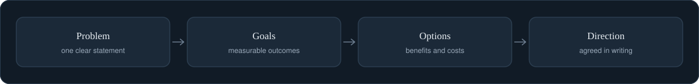

[Back to profile](https://github.com/denisans)



*About 5 min read*

## Overview

Turn what I learned into a clear problem statement, goals, and a direction the team can rally around.



## On this page

- [From findings to a direction](#from-findings-to-a-direction)
- [Step 1. Write the problem statement](#step-1-write-the-problem-statement)
- [Step 2. Set an outcome, not a task](#step-2-set-an-outcome-not-a-task)
- [Step 3. Map the opportunity space](#step-3-map-the-opportunity-space)
- [Step 4. Frame two or three options](#step-4-frame-two-or-three-options)
- [Step 5. Choose how you will measure success](#step-5-choose-how-you-will-measure-success)
- [Step 6. Agree and write it down](#step-6-agree-and-write-it-down)
- [Common mistakes](#common-mistakes)
- [How it shows up in my work](#how-it-shows-up-in-my-work)
- [Sources](#sources)

## In short

**Write the problem statement.** One short paragraph that names who, what, and why it matters.

**Set goals.** Outcomes the team can measure, not just tasks to finish.

**Frame the options.** Two or three directions with their benefits and costs.

**Agree on the direction.** A decision from the right people, recorded in writing.

## From findings to a direction

After listening, you hold a pile of notes, complaints, and ideas. This step turns that pile into a **direction the team can rally behind**: a clear problem statement, a measurable goal, and a decision about which path to take.

The danger here is to jump from a pile of notes straight to a favorite solution. The way to avoid it is to work in a fixed order: **outcome, then opportunities, then solutions, then experiments.**

## Step 1. Write the problem statement

One short paragraph that names who is affected, what they cannot do, and why it matters.

```text
[Who] struggles to [do what] because [cause].
This costs [time, money, or risk] and matters because [why now].
```

### Example (illustrative)

> Support staff spend about 45 minutes every week turning a findings list into a status slide. The list has no built-in view of release risk, so the manager's one question, "what is blocking the release?", is answered by hand.

Test the statement: it should name a person, describe a behavior, and contain no solution. If it contains the word "dashboard" or "app", it is a solution wearing a problem's clothes.

## Step 2. Set an outcome, not a task

A goal such as "build a risk summary" describes work. A good goal describes a **change**:

| Task (weak) | Outcome (strong) |
|---|---|
| Build a risk summary page | Cut weekly status preparation from 45 minutes to under 10 |
| Add an export button | Managers see open Critical findings without asking |

An outcome has three parts: **who** changes, **what** changes in their behavior or result, and **by how much**, by when.

## Step 3. Map the opportunity space

The **Opportunity Solution Tree**, introduced by the product coach Teresa Torres, is a simple picture that keeps the order straight. It has four levels:

```text
Outcome                 Cut weekly status preparation to under 10 minutes
  |
  +-- Opportunity A     Counting statuses by hand is slow and error-prone
  |     +-- Solution A1     A summary command that counts for us
  |     +-- Solution A2     A dashboard with live counts
  |
  +-- Opportunity B     The slide needs data from three places
  |     +-- Solution B1     One shared findings list
  |
  +-- Opportunity C     Nobody knows which findings block the release
        +-- Solution C1     Mark release blockers and show them first
```

The point of the tree is that **you compare opportunities before you compare solutions.** Each opportunity is a need, pain point, or desire found in your research. Each solution is one way to serve it. Under each solution sit the experiments you could run to test whether it works.

This protects the team from two common failures: choosing the first idea, and arguing about solutions that serve different opportunities.

## Step 4. Frame two or three options

For the opportunity you decide to pursue, lay out the realistic choices, including the smallest one.

| Option | What it is | Benefit | Cost and risk |
|---|---|---|---|
| A. Do nothing | Keep the manual process | No effort | 45 minutes a week continues |
| B. Small | A command that prints counts by status | Quick, easy to test | Still needs a manual step for the slide |
| C. Full | A shared dashboard that updates itself | Removes the work | More effort, more to maintain |

Recommend one, and say why. A recommendation with its reasoning is far more useful to a decision maker than a menu.

## Step 5. Choose how you will measure success

A simple structure from Google's UX research team, **Goals, Signals, Metrics**, helps turn a fuzzy aim into something countable:

- **Goal:** what we want to achieve, in plain words.
- **Signal:** what we would observe if it were happening.
- **Metric:** the number that captures the signal.

| Goal | Signal | Metric |
|---|---|---|
| Faster status preparation | Less time spent on the weekly slide | Minutes per week, self-reported or timed |
| Managers see risk directly | Fewer "what is blocking us?" questions | Count of ad-hoc requests per week |

The same team suggests a set of five categories, called **HEART**, to choose from: Happiness, Engagement, Adoption, Retention, and Task success. Do not use all five. Pick the one or two that match your goal. For a new tool, **Adoption** and **Task success** are usually the right pair.

## Step 6. Agree and write it down

The final output is a **one-page brief** that the decision makers have seen and accepted.

```text
ONE-PAGE BRIEF
Problem:      (2 to 3 sentences)
Who:          (the people affected)
Outcome:      (what changes, by how much, by when)
Options:      (A, B, C with the recommendation)
Decision:     (chosen option, decided by whom, on what date)
Success:      (metric, target, check date)
Out of scope: (what we are deliberately not doing)
Risks and open questions:
```

The "Out of scope" line matters. It is the cheapest protection against scope growing quietly.

## Common mistakes

- **Smuggling a solution into the problem statement.**
- **A goal that is really a to-do list.** "Launch X" is not an outcome.
- **Comparing solutions that address different needs.** Fix the opportunity first.
- **No "do nothing" option.** Without it, there is no honest baseline.
- **A brief nobody signed off.** If the decision maker has not agreed in writing, the direction is not decided.

## How it shows up in my work

The **qa-tracker** design reflects a framed problem: findings need one list that everyone trusts. So the data lives in a single file, and there is a single, checked way to change it. The project's rules (preview first, QA closes findings after a retest) are the written-down result of that decision.

## What it produces

- A problem statement
- Goals and success measures
- A one-page brief with the chosen direction

## Sources

- [Outcomes vs. outputs (Product Talk)](https://www.producttalk.org/outcomes-vs-outputs/)
- [Opportunity solution trees (Product Talk)](https://www.producttalk.org/opportunity-solution-trees/)
- [The Goals, Signals, Metrics approach with HEART](https://www.productcompass.pm/p/the-google-heart-framework)
- [HEART at a glance](https://learningloop.io/glossary/heart-framework)

---

[Back to profile](https://github.com/denisans)
