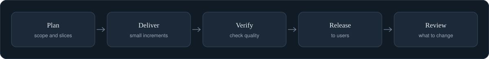

[Back to profile](https://github.com/denisans)



*About 5 min read*

## Overview

I focus on turning ideas into usable product progress: small steps, quick feedback, and continuous improvement rather than big-bang releases.



## On this page

- [What delivery focus means](#what-delivery-focus-means)
- [Four principles](#four-principles)
- [1. Slicing the work](#1-slicing-the-work)
- [2. Definition of Done](#2-definition-of-done)
- [3. Risks, assumptions, issues, dependencies](#3-risks-assumptions-issues-dependencies)
- [4. Release in small steps](#4-release-in-small-steps)
- [5. Measure delivery health](#5-measure-delivery-health)
- [A status report that people read](#a-status-report-that-people-read)
- [Common mistakes](#common-mistakes)
- [How it shows up in my work](#how-it-shows-up-in-my-work)
- [Sources](#sources)

## In short

**Slice the work.** Large goals are split into increments that can be delivered and checked on their own.

**Track risks and dependencies.** Risks are named early with an owner and a next step.

**Release in small steps.** Smaller releases are easier to test and easier to undo.

**Close the loop.** Feedback is captured and fed into the next iteration.

## What delivery focus means

Delivery focus is the commitment to getting useful work **into people's hands in small steps**, rather than disappearing for months and unveiling a large release. It is not about working faster. It is about shortening the distance between an idea and real feedback.

A large release hides risk. Everything is tested together, late, and a single problem can delay all of it. Small releases spread the risk across many cheap, reversible steps.

## Four principles

1. **Slice the work vertically.** Each increment should deliver something a user can notice, not just a layer of the system.
2. **Make risks and dependencies visible early**, with an owner and a next step.
3. **Define "done" before starting**, so everyone judges completion the same way.
4. **Close the loop.** Every release ends with a short review that feeds the next plan.

## 1. Slicing the work

There are two ways to cut a feature. The wrong one is *horizontal*: build all the database, then all the logic, then all the screens. Nothing works until the last layer is done. The right one is *vertical*: build a thin slice through every layer so that a user can complete one small task from start to finish.

### Example (illustrative): "Guests can book a room"

| Slice | What a user can do afterwards |
|---|---|
| 1 | Search for rooms by date and see a price |
| 2 | Choose a room and enter guest details |
| 3 | Pay and receive a booking confirmation |
| 4 | Receive an invoice by email |
| 5 | Rate the stay after check-out |

After slice 1 the team already has something to show and something to learn from. If search turns out to be confusing, it is found in week one, not week ten.

A slice is a good size when it can be finished in a few days, shown to a stakeholder, and tested on its own.

## 2. Definition of Done

"Done" means different things to different people unless it is written down. A **Definition of Done** is a short checklist that every item must satisfy.

```text
Definition of Done
[ ] Meets the acceptance criteria written in the requirement
[ ] Reviewed by a second person
[ ] Tested, including at least one failure case
[ ] No open Critical or High findings
[ ] Documentation or release note updated
[ ] Product owner has seen it working
```

Keep it short. A list that is too long gets ignored.

## 3. Risks, assumptions, issues, dependencies

A simple register, often called **RAID**, keeps the uncomfortable things visible.

| Type | Meaning | Example |
|---|---|---|
| **R**isk | Might happen | Payment provider approval may take longer than planned |
| **A**ssumption | We believe it is true | The hotel has one admin who updates prices |
| **I**ssue | Already happening | Test data was overwritten yesterday |
| **D**ependency | We need something from someone else | Brand images from the design team |

For each row, record an **owner**, a **next step**, and a **date**. A risk with no owner is only a worry.

## 4. Release in small steps

Smaller releases are easier to test, easier to understand, and easier to undo. A good release habit is to answer three questions before every release:

- What exactly is changing, in one sentence?
- How will we know it is working?
- How do we go back if it is not?

If the third question has no answer, the release is not ready.

## 5. Measure delivery health

Four measures from DORA research describe how healthy delivery is:

| Metric | Question |
|---|---|
| Deployment frequency | How often do we release? |
| Lead time for changes | How long from finished change to live? |
| Change failure rate | How often does a release cause a problem? |
| Time to restore | How fast do we recover? |

Use them to see trends in the *system*, and to find where work gets stuck. Do not use them to compare individuals.

## A status report that people read

```text
Overall: Green | Amber | Red        (one sentence of reason)

Progress against plan
  Delivered: ...
  In progress: ...
  Next: ...

Risks and blockers (owner, next step, date)
Decisions needed (from whom, by when)
```

The color is a conversation starter, not a judgment. Amber means "I need to tell you something early". A project that is never amber is usually hiding something.

## Common mistakes

- **Big-bang releases.** Everything lands at once, and so does every problem.
- **Horizontal slices.** Weeks of work with nothing a user can try.
- **A Definition of Done that exists but is not used.**
- **A risk log that is written once and never read again.**
- **Reporting only good news**, which teaches stakeholders to stop trusting the report.
- **Measuring speed without stability**, which rewards fast, broken releases.

## How it shows up in my work

The **qa-tracker** project reflects these ideas in miniature: the dashboard shows the status of every finding, a summary command reports release risk, and automatic validation runs on every push, so problems are visible before they reach a release.

## What it produces

- A delivery plan with milestones and owners
- A risk and dependency list
- Release notes and a short review after each step

## Where it shows up

- [qa-tracker](https://github.com/denisans/denisans/blob/main/details/qa-tracker.md)

## Sources

- [The four DORA metrics explained](https://codefresh.io/learn/software-deployment/dora-metrics-4-key-metrics-for-improving-devops-performance)
- [How to run a retrospective after each release](https://project-management.com/sprint-retrospective/)
- [Defect triage and release readiness](https://bug0.com/knowledge-base/defect-triage)

---

[Back to profile](https://github.com/denisans)
