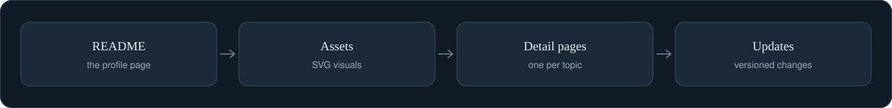
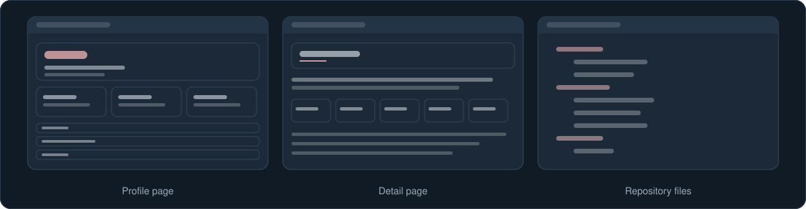

[Back to profile](https://github.com/denisans)

**Repository:** [denisans/denisans](https://github.com/denisans/denisans) &nbsp;|&nbsp; **Stack:** Markdown, SVG

## Overview

This repository holds the profile README that you are reading, the SVG visuals it uses, and the detail pages that each View details link opens. Every change is saved as a numbered version so it can be rolled back.

## How the profile is built

Each part lives in its own place.

## Screens

Simplified sketches of the main screens.

## What is inside

| Part | What it holds | Where |
|---|---|---|
| **Profile page** | The introduction, sections, and repository cards | `README.md` |
| **Visuals** | The hero, workflow, repository cards, and banners, drawn as SVG | `assets/` |
| **Detail pages** | One page for every View details link | `details/` |

## How it works

- The visuals carry their own background, so they look the same in GitHub's light and dark themes.
- Motion is slow and subtle, and it is switched off for visitors who prefer reduced motion.
- Every image has a text alternative.

## Technology

- Markdown
- SVG with CSS animation

## Status and next steps

**Status:** Maintained.

- Replace the placeholder links with the final LinkedIn and email.
- Review the wording of each detail page.

---

[Back to profile](https://github.com/denisans) &nbsp;|&nbsp; [Open the repository](https://github.com/denisans/denisans)
