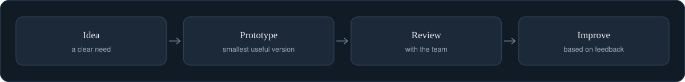

[Back to profile](https://github.com/denisans)



*About 14 min read*

## Overview

I build, iterate, and improve with intention. Crownsky, Cafe_Management, and qa-tracker are practical examples of turning an idea into something people can use.



## On this page

- [What I mean by "engineering mindset"](#what-i-mean-by-engineering-mindset)
- [The loop](#the-loop)
- [Part 1. Build the smallest thing that works](#part-1-build-the-smallest-thing-that-works)
- [Part 2. Test the checker](#part-2-test-the-checker)
- [Part 3. Run the checks automatically on every change](#part-3-run-the-checks-automatically-on-every-change)
- [Part 4. Save every change as a clear, reversible version](#part-4-save-every-change-as-a-clear-reversible-version)
- [Part 5. Write down why](#part-5-write-down-why)
- [Part 6. Measure the health of delivery](#part-6-measure-the-health-of-delivery)
- [Questions I ask engineers](#questions-i-ask-engineers)
- [Common mistakes](#common-mistakes)
- [How it shows up in my work](#how-it-shows-up-in-my-work)
- [Sources](#sources)

## In short

**Build small, then improve.** A first version that works teaches more than a perfect plan.

**Keep things traceable.** Changes are saved as versions, so any step can be reviewed or rolled back.

**Automate repeated work.** Checks and reports that run on their own free the team for the work that needs judgement.

**Speak the team's language.** I work with engineers from a product point of view and ask for clarity on trade-offs.

## What I mean by "engineering mindset"

I am a product and project person, not a full-time engineer. When I say engineering mindset, I mean a set of working habits that engineers use and that make any team calmer and faster:

1. **Build the smallest thing that works**, then improve it.
2. **Let a computer check the boring things**, so people can spend time on judgment.
3. **Save every change as a named version**, so nothing is ever lost and any step can be undone.
4. **Write down why** a decision was made, so the reasoning survives longer than the meeting.
5. **Measure the health of delivery**, not only the amount of work.

This page walks through each habit with real, runnable code. The code is a simplified teaching version, written in the same spirit as the `qa-tracker` project on this profile. It is not a copy of that project's code. Every snippet below was run before it was published, and the output you see is the real output.

You do not need to read code to follow the page. Each block is followed by a plain explanation, line by line, and a short note on what a product person should take from it.

## The loop

Habit 1 to 5 form a loop. A change is made, checked automatically, saved as a version, explained in a short record, and then measured.

| Step | What happens | Tool used on this page |
|---|---|---|
| Build | Write a small piece of working code | Python |
| Check | Run automatic tests on every change | pytest and GitHub Actions |
| Save | Store the change with a clear message | Git and Conventional Commits |
| Explain | Record why the decision was made | A decision record (ADR) |
| Measure | Watch speed and stability of delivery | The four DORA metrics |

## Part 1. Build the smallest thing that works

### The problem

A QA team collects bug reports in a shared file. Over time the file fills with small mistakes: an ID typed as `qa-1`, a status nobody agreed on, a date written as `12/11/2026`. Each mistake looks harmless, but together they make reports, dashboards, and handovers unreliable.

The fix is a small program that reads each finding and lists what is wrong with it. Here it is.

**File: `findings.py`**

```python
"""A small, generic findings checker (a simplified cousin of a `validate` command)."""
import re
from dataclasses import dataclass

STATUSES = {"New", "In progress", "Ready for retest", "Closed"}
SEVERITIES = ["Critical", "High", "Medium", "Low"]
ID_PATTERN = re.compile(r"QA-\d{4}")
DATE_PATTERN = re.compile(r"\d{4}-\d{2}-\d{2}")


@dataclass
class Finding:
    id: str
    title: str
    severity: str
    status: str = "New"
    reported_on: str = ""


def check(finding: Finding) -> list[str]:
    """Return a list of problems. An empty list means the finding is valid."""
    problems = []
    if not ID_PATTERN.fullmatch(finding.id):
        problems.append(f"id must look like QA-0001, got {finding.id!r}")
    if not finding.title.strip():
        problems.append("title is required")
    if finding.severity not in SEVERITIES:
        problems.append(f"severity must be one of {SEVERITIES}")
    if finding.status not in STATUSES:
        problems.append(f"status must be one of {sorted(STATUSES)}")
    if finding.reported_on and not DATE_PATTERN.fullmatch(finding.reported_on):
        problems.append("reported_on must use YYYY-MM-DD")
    return problems


def check_all(findings: list[Finding]) -> list[str]:
    """Check every finding and also catch duplicate ids."""
    problems, seen = [], set()
    for f in findings:
        if f.id in seen:
            problems.append(f"{f.id}: duplicate id")
        seen.add(f.id)
        problems += [f"{f.id}: {p}" for p in check(f)]
    return problems


if __name__ == "__main__":
    sample = [
        Finding("QA-0001", "Checkout button does nothing", "High"),
        Finding("QA-0002", "", "Urgent", reported_on="12/11/2026"),
    ]
    issues = check_all(sample)
    for line in issues:
        print("PROBLEM:", line)
    print("OK" if not issues else f"{len(issues)} problem(s) found")
    raise SystemExit(1 if issues else 0)
```

### Reading it line by line

**The first lines** (`import re`, `from dataclasses import dataclass`) bring in two tools that ship with Python. `re` is for pattern matching. `dataclass` is a shortcut for describing a record that has named fields.

**`STATUSES` and `SEVERITIES`** are the agreed vocabulary. Keeping them in one place means there is exactly one answer to the question "what statuses are allowed?". A set (`{...}`) is used for statuses because order does not matter. A list (`[...]`) is used for severities because the order, from Critical down to Low, does matter.

**`ID_PATTERN` and `DATE_PATTERN`** are patterns. `QA-\d{4}` reads as "the letters QA, a dash, then exactly four digits". `\d{4}-\d{2}-\d{2}` reads as "four digits, dash, two digits, dash, two digits", which is the date shape 2026-11-12.

**`class Finding`** describes one bug report: an `id`, a `title`, a `severity`, a `status`, and a `reported_on` date. The `= "New"` means that a new finding starts as New unless someone says otherwise.

**`def check(finding)`** looks at one finding and returns a list of problems. It starts with an empty list and adds a sentence for every rule that is broken. If the list is empty at the end, the finding is fine. Returning a list of sentences, instead of stopping at the first error, is a deliberate choice: the person fixing the data sees everything wrong in one pass.

**`def check_all(findings)`** runs `check` on every finding and also catches something a single finding cannot reveal: two findings that share the same ID. The variable `seen` remembers the IDs already met.

**The last block** (`if __name__ == "__main__":`) runs only when the file is started directly. It tries two sample findings, prints each problem, and then exits with code `0` when everything is fine or `1` when something is wrong. That exit code matters later, because it is how a computer, not a person, learns that a check failed.

### What it prints

Running `python findings.py` on the two sample findings gives:

```text
PROBLEM: QA-0002: title is required
PROBLEM: QA-0002: severity must be one of ['Critical', 'High', 'Medium', 'Low']
PROBLEM: QA-0002: reported_on must use YYYY-MM-DD
3 problem(s) found
```

The first sample, `QA-0001`, passes quietly. The second breaks three rules, and all three are reported together.

### What a product person should take from this

- A rule that is written once, in code, is applied the same way every time. A rule that lives in someone's head is applied differently on a busy day.
- The messages are written for the person who has to fix the data. "title is required" is better than "invalid input".
- The program is about forty lines. Small tools like this are quick to build and easy to review, which is why they are a good first step.

## Part 2. Test the checker

A checker that nobody checks is a risk. A **test** is a tiny program that feeds known input to the code and states what the answer must be. If the code is later changed and the answer changes, the test fails loudly.

**File: `test_findings.py`**

```python
import pytest
from findings import Finding, check, check_all


def test_valid_finding_has_no_problems():
    assert check(Finding("QA-0001", "Checkout fails", "High")) == []


def test_empty_title_is_reported():
    problems = check(Finding("QA-0001", "  ", "High"))
    assert "title is required" in problems


@pytest.mark.parametrize("bad_id", ["QA-1", "qa-0001", "BUG-0001", ""])
def test_bad_ids_are_rejected(bad_id):
    assert any("id must look like" in p for p in check(Finding(bad_id, "x", "Low")))


def test_duplicate_ids_are_caught():
    twins = [Finding("QA-0001", "a", "Low"), Finding("QA-0001", "b", "Low")]
    assert "QA-0001: duplicate id" in check_all(twins)
```

### Reading it line by line

- **`import pytest`** loads pytest, a widely used Python testing tool. A test in pytest is simply a function whose name starts with `test_` and that uses a plain `assert` statement. If the statement is false, the test fails.
- **`test_valid_finding_has_no_problems`** says: a good finding must produce an empty list.
- **`test_empty_title_is_reported`** says: a title made only of spaces must produce the message "title is required". It proves that the rule really works, not just that it exists.
- **`@pytest.mark.parametrize("bad_id", [...])`** runs the same test four times with four different bad IDs: `QA-1`, `qa-0001`, `BUG-0001`, and an empty string. One short test covers four cases, and the report shows each case separately.
- **`test_duplicate_ids_are_caught`** checks the one rule that only `check_all` can see.

Run `pytest -q` and the result is:

```text
.......                                                                  [100%]
7 passed in 0.02s
```

Seven dots, seven passing checks. The count is seven because the parametrized test counts as four.

**What to take from this:** each test is a sentence in a specification. Reading the test names alone tells you what the checker promises. When a product person asks "what happens if the ID is wrong?", the answer is not an opinion, it is a test that either passes or fails.

## Part 3. Run the checks automatically on every change

Tests help only if someone runs them. The engineering answer is to remove the "someone". **Continuous integration (CI)** means a server runs the checks every time code is pushed. On GitHub this is done with a *workflow* file stored in the repository at `.github/workflows/`.

**File: `ci.yml`**

```yaml
name: Check data and tests
on:
  push:
    branches: [main]
  pull_request:
jobs:
  check:
    runs-on: ubuntu-latest
    steps:
      - uses: actions/checkout@v4
      - uses: actions/setup-python@v5
        with:
          python-version: "3.12"
      - run: pip install pytest
      - run: pytest -q
```

### Reading it line by line

- **`name`** is the label shown in the GitHub Actions tab.
- **`on`** says when to run. Here: every push to the `main` branch, and every pull request. A pull request is a proposed change waiting for review, so the checks run *before* the change is accepted.
- **`jobs` / `check`** defines one job called `check`. A workflow can have several jobs that run in parallel or one after another.
- **`runs-on: ubuntu-latest`** asks GitHub for a clean Linux machine. "Clean" is the point: the checks must pass on a fresh machine, not only on one person's laptop.
- **`steps`** are the commands, run in order. `actions/checkout` downloads the repository. `actions/setup-python` installs Python 3.12. `pip install pytest` installs the test tool. `pytest -q` runs the tests.

If any step exits with an error, the job turns red, and GitHub shows a red cross next to the commit. A red cross is the machine saying "do not merge this yet".

### The real example on this profile

The `qa-tracker` repository uses the same idea. Its workflow runs when files in `data/`, `scripts/`, or `dashboard/` change. It then runs the project's own `validate` command, followed by the command that builds the dashboard. In other words, the data file cannot quietly become invalid: a bad edit is stopped by the build, not discovered weeks later in a meeting.

**What to take from this:** automation is a form of kindness to the team. Nobody has to remember to run the checks, and nobody has to be the person who says "you broke it". The build says it, impersonally and immediately.

## Part 4. Save every change as a clear, reversible version

Git records every change as a **commit**, which is a labeled snapshot. The label, called the commit message, is what makes the history readable later. A popular convention for the label is **Conventional Commits**. Its shape is:

```text
type(scope): short description
```

The *type* says what kind of change it is. The two types with a defined meaning are `feat` (a new capability) and `fix` (a bug fix). Teams commonly add others such as `docs`, `refactor`, `test`, `ci`, and `chore`. A `!` after the type, or a `BREAKING CHANGE:` line in the message body, marks a change that breaks something that used to work.

Here are real-looking examples, each of which was checked against a pattern in code:

```text
feat(dashboard): add export to CSV
fix: stop duplicate ids when adding a finding
docs: explain who can close a finding
feat!: rename the status values
```

The same convention connects directly to **Semantic Versioning**, the `MAJOR.MINOR.PATCH` numbering of releases:

| Commit type | Version bump | Example |
|---|---|---|
| `fix` | PATCH | 1.4.2 to 1.4.3 |
| `feat` | MINOR | 1.4.2 to 1.5.0 |
| Any type with `!` or `BREAKING CHANGE` | MAJOR | 1.4.2 to 2.0.0 |

Why a product person cares: the history becomes a plain-language change log, and the next version number follows from what actually changed.

### How `qa-tracker` handles versions

The `qa-tracker` data file is treated with the same respect. All changes go through one command-line tool, never by hand. The commands that change data show a **preview** first. Only when the person adds `--yes` is the change written, and `--commit` additionally creates a Git commit and a version tag. Rolling back means returning to an earlier tag. The design principle is: *no change without a preview, and no change that cannot be undone.*

## Part 5. Write down why

Code shows *what* the system does. It rarely shows *why* it was built that way. An **Architecture Decision Record (ADR)** is a short note that captures one decision. The format most teams use was proposed by Michael Nygard in 2011 and has five parts: a title, a status, the context, the decision, and the consequences.

Here is a short, illustrative example. The decision is invented for teaching purposes.

```markdown
# 3. Keep QA findings in a single JSON file

Status: Accepted

## Context
The team needs one list of findings that the PM, QA, and developers
all trust. Today findings live in chat messages and personal notes.
We have no budget for a database and about 200 findings per quarter.

## Decision
We keep all findings in one JSON file in the repository. Changes go
through a command-line tool that validates every record.

## Consequences
+ Every change is versioned and can be rolled back.
+ No server to run or pay for.
- Two people editing at once can cause a merge conflict.
- If findings grow past a few thousand, we will need a database.
  We will revisit this decision then.
```

Notice the honest last two lines. A good ADR does not sell the decision, it states the price. When the situation changes, a new ADR is written that says the old one is *superseded*. The old record stays, because the history of reasoning is the valuable part.

## Part 6. Measure the health of delivery

How do you know whether the habits above are working? Research by the DevOps Research and Assessment group (DORA) settled on four measures that, together, describe the speed and stability of software delivery:

| Metric | The question it answers |
|---|---|
| Deployment frequency | How often do we release to users? |
| Lead time for changes | How long from a finished change to it being live? |
| Change failure rate | What share of releases cause a problem? |
| Time to restore service | How fast do we recover when something breaks? |

The first two measure **speed**. The last two measure **stability**. The insight is that strong teams are not trading one for the other: they release often *and* recover quickly. Small, automatically checked, easily reversed changes, the habits on this page, are exactly what makes that possible.

A caution: these are measures of a *system*, not of people. Used to rank individuals, they stop being honest.

## Questions I ask engineers

Because I come from the product side, the most useful thing I can do is ask clear questions about trade-offs. These are the ones I use most:

- What is the smallest version we could ship to learn something real?
- How will we know if this change broke something? Is there a test or a check for it?
- How do we undo it if it goes wrong?
- What are we choosing not to do, and what does that cost us later?
- Which part of this is a decision that should be written down?

## Common mistakes

- **Automating before understanding.** A check that enforces a rule nobody agreed on only creates friction. Agree on the rule first.
- **Tests that only test the happy path.** The value is in the bad IDs, the empty titles, and the duplicates.
- **Huge commits.** A commit that changes everything cannot be reviewed or reversed cleanly.
- **Records that are never written.** The decision that "everyone remembers" is forgotten within a quarter.
- **Using metrics to judge people.** Measure the system and the flow of work, not individuals.

## How it shows up in my work

- **qa-tracker** applies habits 2 and 3 directly: validation on every push, and previewed, versioned changes with tags for rollback.
- **Crownsky** and **Cafe_Management** are working prototypes, built small and kept in separate repositories so each can be improved on its own.

## What it produces

- Working prototypes such as the repositories on this profile
- Automated checks that keep data and documents consistent
- Versioned changes that are easy to roll back

## Where it shows up

- [Crownsky](https://github.com/denisans/denisans/blob/main/details/crownsky.md)
- [Cafe_Management](https://github.com/denisans/denisans/blob/main/details/cafe-management.md)
- [qa-tracker](https://github.com/denisans/denisans/blob/main/details/qa-tracker.md)

## Sources

- [Conventional Commits specification](https://www.conventionalcommits.org/en/v1.0.0/)
- [Martin Fowler on Architecture Decision Records](https://www.martinfowler.com/bliki/ArchitectureDecisionRecord.html)
- [Michael Nygard's decision record template, summarized](https://github.com/peter-evans/lightweight-architecture-decision-records)
- [pytest basics (Microsoft Learn)](https://learn.microsoft.com/en-us/training/modules/test-python-with-pytest/2-pytest-basics)
- [Defining a GitHub Actions workflow](https://carpentries-incubator.github.io/byte-sized-rse-ci/defining-a-workflow.html)
- [The four DORA metrics explained](https://codefresh.io/learn/software-deployment/dora-metrics-4-key-metrics-for-improving-devops-performance)

---

[Back to profile](https://github.com/denisans)
