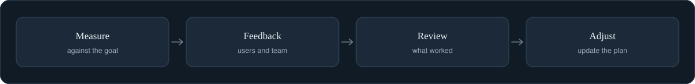

[Back to profile](https://github.com/denisans)



*About 6 min read*

## Overview

Review results, capture feedback, and feed it back into the next iteration.



## On this page

- [Why learning is a step, not an afterthought](#why-learning-is-a-step-not-an-afterthought)
- [The four activities](#the-four-activities)
- [1. Measure against the goal](#1-measure-against-the-goal)
- [2. Collect feedback](#2-collect-feedback)
- [3. Run a retrospective](#3-run-a-retrospective)
- [4. Feed it forward](#4-feed-it-forward)
- [Worked example (illustrative)](#worked-example-illustrative)
- [Template: a learning review](#template-a-learning-review)
- [Common mistakes](#common-mistakes)
- [How it shows up in my work](#how-it-shows-up-in-my-work)
- [Sources](#sources)

## In short

**Measure the result.** Compare what happened with the goal that was set.

**Collect feedback.** From users, stakeholders, and the delivery team.

**Review as a team.** A short, blame-free look at what worked and what did not.

**Feed it forward.** Lessons become changes to the backlog and to the way we work.

## Why learning is a step, not an afterthought

Shipping is not the end of the work. It is the moment when the team finally gets **real evidence**. The learning step turns that evidence into better decisions, so that the next iteration starts smarter than the last.

Skipping it has a cost that is easy to miss: the team keeps making the same mistakes and the same wins stay accidental.

## The four activities

1. **Measure** the result against the goal that was set.
2. **Collect feedback** from users, stakeholders, and the team.
3. **Review** as a team: what worked, what did not, and why.
4. **Adjust** the backlog and the way of working.

## 1. Measure against the goal

The measure was chosen back when the opportunity was defined. Now compare. For each goal, ask three questions:

- What did we expect to happen?
- What actually happened?
- What explains the difference?

### Choosing what to look at: HEART

Google's UX research team grouped user-centered measures into five categories, known as **HEART**:

| Category | What it tells you | Example signal |
|---|---|---|
| **H**appiness | How people feel | Satisfaction rating, feedback comments |
| **E**ngagement | How much they use it | Visits per week |
| **A**doption | How many new people start | New sign-ups, first use of a feature |
| **R**etention | Whether they come back | Users still active after 4 weeks |
| **T**ask success | Whether they can do the job | Completion rate, errors, time to finish |

Do not track all five. Pick the one or two that match the goal. A new feature usually cares about adoption and task success. A product that people already use may care more about retention and happiness.

### A caution about numbers

A number tells you *what* happened. It rarely tells you *why*. Pair every important metric with a few short conversations, so that you understand the reason behind it.

## 2. Collect feedback

| Source | What it is good for | Watch out for |
|---|---|---|
| Users | Whether the problem is really solved | Polite answers; ask about what they did, not what they think |
| Stakeholders | Whether the business goal is met | Opinions about taste mixed with facts |
| Delivery team | What slowed the work down | Things people hesitate to say in public |
| Data | Patterns across many people | Missing context |

Make feedback easy to give. A short form, a short call, or a standing question at the end of each demo is better than a long survey.

## 3. Run a retrospective

A **retrospective** is a short meeting held at regular intervals, for the team to reflect on *how it worked*, not on what it delivered. It is the one meeting dedicated entirely to improving the way of working.

### Ground rules

- It is **blame-free.** The aim is to understand the system, not to find a culprit.
- Everyone speaks. Quiet people often hold the most useful observations.
- It ends with **a small number of actions**, each with an owner.

### A simple agenda (about 60 minutes)

```text
1. Set the stage (5 min)      Purpose, ground rules, review last actions
2. Gather (15 min)            Everyone writes notes silently
3. Group and vote (10 min)    Find the themes, vote on what matters most
4. Discuss (20 min)           Look at causes of the top themes
5. Decide (10 min)            1 to 3 actions with owners
```

### Formats to rotate

Using the same format every time makes the meeting stale. These are common alternatives:

| Format | Questions |
|---|---|
| **What went well / What did not / What to change** | The classic, good for new teams |
| **Start, Stop, Continue** | Short and action-oriented |
| **4Ls** | What we Liked, Learned, Lacked, Longed for; balances positives and problems |
| **Mad, Sad, Glad** | Surfaces feelings that a task-focused format misses |
| **Sailboat** | Wind (what helps), anchors (what slows us), rocks (risks), destination (our goal) |

### Good and weak actions

| Weak | Why | Better |
|---|---|---|
| "Improve communication" | Too vague to do | "Post a status update every Thursday by noon" |
| "Test more" | No owner, no limit | "Add a failure-case test to every new story; QA reviews the first three" |
| Ten actions | None will be done | Pick the top one to three |

Start the next retrospective by checking last time's actions. An action that is never reviewed teaches the team that retrospectives do not matter.

## 4. Feed it forward

Learning only counts if it **changes something**. Three places to put the result:

- **The backlog:** new items, changed priorities, items removed.
- **The way of working:** the checklist, the template, the meeting rhythm.
- **The decision log:** update or supersede the earlier decision, and say why.

## Worked example (illustrative)

*Invented for teaching.*

**Goal set earlier:** cut weekly status preparation from 45 minutes to under 10.

**Result after four weeks:** the median time is now 15 minutes.

**What explains it:** counting is automatic, but three people still paste the summary into slides by hand.

**Feedback:** the manager is happy with the content, but wants the list of release blockers at the top.

**Actions from the retrospective:**
1. Move "release blockers" to the top of the summary. Owner: PM. This week.
2. Test whether a ready-made slide layout saves the remaining time. Owner: QA lead. Two weeks.

**Backlog change:** the PDF export, previously ranked high, moves to "Later". The need it served is mostly met.

Notice that the result was *good but not at target*, and that is useful: it shows exactly which step to work on next.

## Template: a learning review

```text
GOAL AND TARGET:
RESULT:                  (number, and how it was measured)
WHAT EXPLAINS IT:
FEEDBACK:                (users, stakeholders, team)
WHAT WE WILL CHANGE:     (backlog, process, decisions; 1 to 3 items)
OWNERS AND DATES:
NEXT CHECK:
```

## Common mistakes

- **Celebrating output** ("we shipped it") instead of checking the outcome.
- **Measuring only what is easy.**
- **Blaming people** in the retrospective, which makes everyone quieter next time.
- **Too many actions, no owners.**
- **No follow-up** on last time's actions.
- **Learning that stays in people's heads**, and leaves with them.

## How it shows up in my work

The versioning habit in **qa-tracker** is a learning tool as much as a safety net: every change to the data is stored as a numbered version with a short summary, so the history of what changed, and why, can be reviewed later.

## What it produces

- A short results summary
- A list of lessons learned
- Updates to the backlog and process

## Sources

- [How to run a sprint retrospective, with agenda and formats](https://project-management.com/sprint-retrospective/)
- [Retrospective formats and how to avoid boring ones](https://agilepainrelief.com/blog/agile-retrospectives/)
- [The HEART framework and Goals, Signals, Metrics](https://www.productcompass.pm/p/the-google-heart-framework)
- [HEART at a glance](https://learningloop.io/glossary/heart-framework)

---

[Back to profile](https://github.com/denisans)
