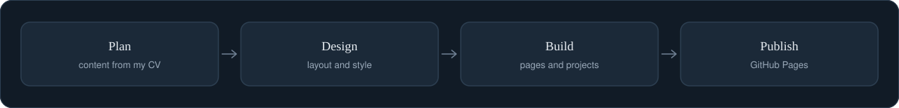
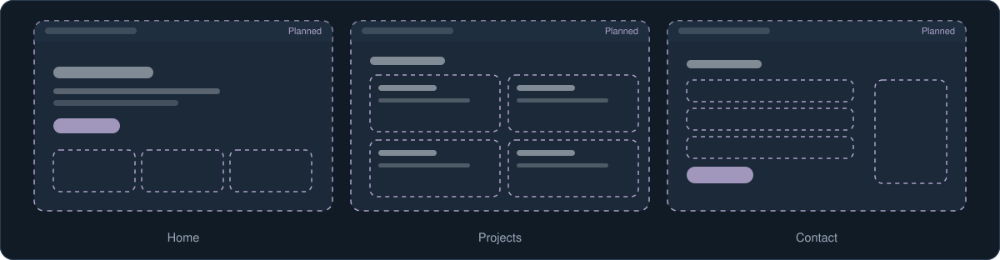

[Back to profile](https://github.com/denisans)

**Repository:** [denisans/portofolio.github.io](https://github.com/denisans/portofolio.github.io) &nbsp;|&nbsp; **Stack:** Planned

## Overview

This repository is reserved for a personal portfolio website. It is empty for now. This page describes what the site will contain and how it will be delivered, so the plan is visible before the first commit.

## Delivery plan

From content to a live site.

## Screens

Simplified sketches of the main screens.

## What is inside

| Section | What it will show | Source |
|---|---|---|
| **Home** | Name, role, and a short introduction | Profile summary |
| **About** | Background and the way I work | My CV |
| **Experience** | Roles in project management, product management, and business analysis | My CV |
| **Projects** | The repositories featured on this profile, with short case summaries | This GitHub profile |
| **Contact** | How to reach me | Profile links |

## How it works

- The site will reuse the same calm visual style as this profile.
- Each project will get a short case summary: the problem, the approach, and the result.

## Technology

- HTML and CSS
- GitHub Pages for hosting

## Status and next steps

**Status:** Planned. The repository has no files yet.

- Write the content outline from my CV.
- Build the first version of the home page.
- Publish it and link it from this profile.

---

[Back to profile](https://github.com/denisans) &nbsp;|&nbsp; [Open the repository](https://github.com/denisans/portofolio.github.io)
