[Back to profile](https://github.com/denisans)



*About 7 min read*

## Overview

Weigh value, effort, and risk to decide what happens now, what comes next, and what is left out.


## On this page

- [Why prioritization is a skill, not a spreadsheet](#why-prioritization-is-a-skill-not-a-spreadsheet)
- [The process](#the-process)
- [Method 1. RICE scoring](#method-1-rice-scoring)
- [Method 2. MoSCoW](#method-2-moscow)
- [Method 3. Value versus effort](#method-3-value-versus-effort)
- [Method 4. Severity versus priority (for bugs)](#method-4-severity-versus-priority-for-bugs)
- [Sequencing](#sequencing)
- [The "not now" list](#the-not-now-list)
- [Template: a prioritized backlog](#template-a-prioritized-backlog)
- [Common mistakes](#common-mistakes)
- [How it shows up in my work](#how-it-shows-up-in-my-work)
- [Sources](#sources)

## In short

**List everything.** All requests and ideas go into one place.

**Score value, effort, and risk.** A simple, shared scoring so the reasoning is open to review.

**Sequence the work.** Dependencies and deadlines shape the order.

**Say what is left out.** The 'not now' list is communicated, not hidden.

## Why prioritization is a skill, not a spreadsheet

There is always more to do than time allows. Prioritizing is choosing what happens **now, next, later, and not at all**, in a way that other people can follow and, if they disagree, can challenge with facts.

A good prioritization does not need to be mathematically perfect. It needs to be **transparent**: anyone should be able to see why item A sits above item B.

## The process

1. **Collect** every request and idea in one backlog.
2. **Clarify** each item so that it is understood in the same way by everyone.
3. **Score** value, effort, and confidence using a method the team agrees on.
4. **Sequence** by taking dependencies and deadlines into account.
5. **Communicate** the result, including what is *not* being done.

## Method 1. RICE scoring

RICE was created by the product team at Intercom to make roadmap debates less subjective. It breaks the vague question "how important is this?" into four smaller ones.

| Factor | The question | Typical unit |
|---|---|---|
| **R**each | How many people will this affect in a set period? | Users per quarter |
| **I**mpact | How much will it change things for each of them? | 3 massive, 2 high, 1 medium, 0.5 low, 0.25 minimal |
| **C**onfidence | How sure are we about these estimates? | 100% high, 80% medium, 50% low |
| **E**ffort | How much work will it take in total? | Person-months |

The score is:

```text
RICE = (Reach x Impact x Confidence) / Effort
```

Higher is better. Confidence acts as a brake: an exciting idea that rests on guesses is pulled down.

### A runnable calculation

**File: `rice.py`**

```python
"""RICE score = Reach x Impact x Confidence / Effort."""


def rice(reach: int, impact: float, confidence: float, effort: float) -> float:
    if effort <= 0:
        raise ValueError("effort must be greater than zero")
    return reach * impact * confidence / effort


ideas = {
    "Self-service password reset": rice(reach=800, impact=1, confidence=0.8, effort=2),
    "Dark mode":                   rice(reach=1200, impact=0.5, confidence=0.5, effort=3),
    "Export report to PDF":        rice(reach=300, impact=2, confidence=0.9, effort=1.5),
}

for name, score in sorted(ideas.items(), key=lambda kv: kv[1], reverse=True):
    print(f"{score:7.1f}  {name}")
```

**How it works.** The function `rice` multiplies the first three factors and divides by effort. It refuses an effort of zero, because dividing by zero would produce nonsense. The `ideas` dictionary lists three invented ideas with their estimates. The last lines sort the ideas from highest to lowest score and print them.

**What it prints:**

```text
  360.0  Export report to PDF
  320.0  Self-service password reset
  100.0  Dark mode
```

*The ideas and numbers are illustrative.* Notice what happened: "Dark mode" reaches the most people (1,200) but ranks last, because its impact is small, the team is only half sure, and it takes the most effort.

### Using RICE well

- Treat the score as the **start of a conversation**, not the answer. If a ranking feels wrong, find out which estimate is driving it.
- When a gap between two scores is small, prefer the item with less effort.
- Where confidence is low, the next step may be a quick experiment or a few interviews to raise it, not a build.
- Use the same time period for Reach across all items.

## Method 2. MoSCoW

MoSCoW sorts requirements into four groups for a fixed time box. It is simple enough to use in a workshop with stakeholders.

| Group | Meaning | Test |
|---|---|---|
| **M**ust have | The release fails without it | "If this is missing, the release is not usable or not allowed" |
| **S**hould have | Important, but there is a workaround | "Painful to leave out, but we can survive" |
| **C**ould have | Nice to have, first to drop when time is short | "Pleasant, not essential" |
| **W**on't have (this time) | Agreed as out of scope for now | "Recorded, not forgotten" |

The lower-case "o" letters in the name only make it pronounceable. The words "this time" matter: a Won't have can move up in a later release.

**Watch the Musts.** If everything is a Must, nothing has been prioritized. A common guide is to keep Must items to well under the whole capacity so that the team has room for surprises.

MoSCoW tells you *which group* an item belongs to, but not how to rank items inside a group. It combines well with RICE for that.

## Method 3. Value versus effort

A quick, visual method for when you have little data. Place each item on a two-by-two grid.

| | Low effort | High effort |
|---|---|---|
| **High value** | **Quick wins:** do first | **Big bets:** plan carefully |
| **Low value** | **Fill-ins:** do if there is spare time | **Money pits:** avoid |

It is rough, but it is fast and it shows the shape of the backlog at a glance.

## Method 4. Severity versus priority (for bugs)

QA work needs a distinction that is often confused:

- **Severity** describes **how badly** a defect affects the product. It is usually assessed by QA when the bug is logged.
- **Priority** describes **how soon** it should be fixed, taking business context into account. It is usually decided at triage by the product owner or manager.

The two can disagree. A typo in the company name on the home page is *low severity* (nothing breaks) but may be *high priority* (it is embarrassing and easy to fix). A crash in a rarely used admin report is *high severity* but may be *lower priority* if only a few people ever see it.

Keep them as two separate fields. Merging them hides the reasoning.

## Sequencing

A ranked list is not yet a plan. Adjust for:

- **Dependencies:** item B cannot start until item A is finished.
- **Deadlines:** a fixed date can lift an item above its score.
- **Risk:** do the riskiest assumption early, so that you learn while changing course is cheap.
- **Capacity:** people, not the list, set the limit.

Then present the result as **Now, Next, Later**. It communicates order without promising dates that the team cannot yet know.

## The "not now" list

Every prioritization produces losers. If they disappear silently, stakeholders feel ignored and ask again. Keep a visible list of deferred items with the reason and the condition that would bring them back.

```text
Deferred
- Dark mode          Low impact for current users. Revisit if requested by 5+ customers.
- Multi-language     Needs a decision on markets first. Revisit next quarter.
```

## Template: a prioritized backlog

| # | Item | Reach | Impact | Conf. | Effort | RICE | Group | Decision |
|---|---|---|---|---|---|---|---|---|
| 1 | Export report to PDF | 300 | 2 | 90% | 1.5 | 360 | Must | Now |
| 2 | Password reset | 800 | 1 | 80% | 2 | 320 | Should | Next |
| 3 | Dark mode | 1200 | 0.5 | 50% | 3 | 100 | Could | Later |

## Common mistakes

- **False precision.** A score of 342.7 is not more truthful than 340. Do not argue over decimals.
- **Everything is a Must.**
- **Scoring in secret.** Prioritization that stakeholders cannot see feels arbitrary.
- **Ignoring confidence.** Optimistic estimates inflate scores.
- **Never saying no.** A backlog with no "not now" list is a wish list.
- **Merging severity and priority** in a bug tracker.

## How it shows up in my work

The **qa-tracker** data model keeps **severity** (Critical, High, Medium, Low) and **priority** as separate fields, which is the distinction described above, so a finding's technical weight and its urgency can be judged independently.

## What it produces

- A prioritized backlog
- A now, next, later view
- A short note on what was deferred and why

## Sources

- [RICE, from its creators (Intercom)](https://www.intercom.com/blog/rice-simple-prioritization-for-product-managers/)
- [MoSCoW prioritization (ProductPlan)](https://www.productplan.com/glossary/moscow-prioritization/)
- [The MoSCoW method, history and criticism (Wikipedia)](https://en.wikipedia.org/wiki/MoSCoW_method)
- [Bug severity versus priority (Plane)](https://plane.so/blog/bug-severity-vs-priority-in-testing-key-differences)

---

[Back to profile](https://github.com/denisans)
