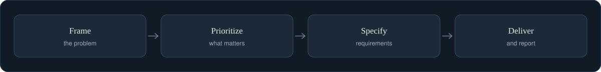

[Back to profile](https://github.com/denisans)



*About 5 min read*

## Overview

The core skills behind turning a need into delivered work: framing the problem, choosing what matters, writing requirements, and managing delivery.



## On this page

- [The skills, and how they connect](#the-skills-and-how-they-connect)
- [1. Product thinking](#1-product-thinking)
- [2. Prioritization](#2-prioritization)
- [3. Requirements](#3-requirements)
- [4. Delivery management](#4-delivery-management)
- [One chain of documents](#one-chain-of-documents)
- [A glossary I use](#a-glossary-i-use)
- [Common mistakes](#common-mistakes)
- [How it shows up in my work](#how-it-shows-up-in-my-work)
- [Sources](#sources)

## In short

**Product thinking.** Framing problems and deciding what is worth building.

**Prioritization.** Weighing value, effort, and risk to choose the order of work.

**Requirements.** Clear, testable descriptions of what the product must do.

**Delivery management.** Plans, owners, risks, and regular updates that keep work moving.

## The skills, and how they connect

Four skills carry a need all the way from an idea to delivered work. They are not separate subjects; each one feeds the next.

```text
Product thinking  ->  Prioritization  ->  Requirements  ->  Delivery management
 "what problem?"      "what first?"       "what exactly?"     "how, and by when?"
```

If an earlier skill is weak, the later ones cannot rescue it. A beautifully managed delivery of the wrong thing is still the wrong thing. That is why I tend to start at the left and work right.

## 1. Product thinking

**The skill:** framing a problem and deciding what is worth building.

| What good looks like | A sign it is missing |
|---|---|
| The problem is stated in the user's terms, without a solution inside it | The first slide is a feature list |
| Success is defined as an outcome with a measure | "Done" means "released" |
| There is a written list of what is *not* being built | Rejected ideas keep coming back |

**Typical artifacts:** a problem statement, a one-page brief, a decision log.

**Go deeper:** [Product thinking](https://github.com/denisans/denisans/blob/main/details/product-thinking.md), [Understand the problem](https://github.com/denisans/denisans/blob/main/details/understand-the-problem.md), [Define the opportunity](https://github.com/denisans/denisans/blob/main/details/define-the-opportunity.md).

## 2. Prioritization

**The skill:** weighing value, effort, risk, and confidence to choose an order, and being open about the reasoning.

| What good looks like | A sign it is missing |
|---|---|
| A single backlog with visible scores | Several competing lists |
| A shared method such as RICE or MoSCoW | Whoever shouts loudest wins |
| A visible "not now" list | Stakeholders keep re-asking |

**Typical artifacts:** a scored backlog, a Now/Next/Later view, a note on what was deferred.

**Go deeper:** [Prioritize](https://github.com/denisans/denisans/blob/main/details/prioritize.md).

## 3. Requirements

**The skill:** describing what the product must do in a way that people can build and test, and that traces back to a need.

| What good looks like | A sign it is missing |
|---|---|
| Each requirement has a reason, an owner, and acceptance criteria | Requirements read like wishes |
| Empty and failure cases are written down | The bugs are found by users |
| Non-functional needs (speed, security) are stated | Surprises appear at the end |

**Typical artifacts:** a PRD or requirement cards, user stories with Given/When/Then criteria, a traceability table.

**Go deeper:** [Build](https://github.com/denisans/denisans/blob/main/details/build.md).

## 4. Delivery management

**The skill:** planning, tracking, and communicating so that work keeps moving and surprises are rare.

| What good looks like | A sign it is missing |
|---|---|
| Work is sliced into small, visible increments | Long periods with nothing to show |
| Risks and dependencies have owners and dates | Problems appear as news |
| A regular update with decisions needed | Stakeholders have to chase for status |

**Typical artifacts:** a delivery plan, a RAID log, a weekly status update, release notes.

**Go deeper:** [Delivery focus](https://github.com/denisans/denisans/blob/main/details/delivery-focus.md), [Collaboration](https://github.com/denisans/denisans/blob/main/details/collaboration.md).

## One chain of documents

The artifacts above link into a single chain, and each one answers a different question.

| Document | Question it answers | Who reads it |
|---|---|---|
| Problem statement | What is wrong, for whom? | Everyone |
| One-page brief | What will we do, and why this option? | Decision makers |
| Scored backlog | In what order? | Team and stakeholders |
| Requirement or story | What exactly will be built? | Team and QA |
| Acceptance criteria | How will we know it is right? | Team and QA |
| Status update | Where are we, and what is needed? | Stakeholders |
| Learning review | What did we learn? | Everyone |

A useful test of the whole chain: pick any line in the status update and trace it back, through the story and the score, to a problem statement. If the trail breaks, something was built without a reason.

## A glossary I use

| Term | Plain meaning |
|---|---|
| Outcome | A change in behavior or result that matters |
| Output | Something the team produces |
| Backlog | The ordered list of work not yet done |
| Increment | A small piece of working product |
| Acceptance criteria | The conditions that make a story done |
| Definition of Done | The checklist every item must pass |
| RACI | Who is Responsible, Accountable, Consulted, Informed |
| RAID | Risks, Assumptions, Issues, Dependencies |
| MVP | The smallest release that teaches us something real |

## Common mistakes

- **Treating the four skills as a menu.** They are a chain; a weak first link weakens the rest.
- **Documents for their own sake.** Write the smallest document that lets the next person do their job.
- **Skipping requirements because the team is small.** The need for shared understanding does not shrink with the team.
- **Reporting activity instead of progress.**

## How it shows up in my work

The repositories on this profile are small, concrete cases of the chain. **Crownsky** is a product with clear user tasks. **qa-tracker** turns a delivery need (one shared list of findings, with a clear status) into a working tool. In both, I read the project through requirements, flows, and screens, which is also how the detail pages describe them.

## What it produces

- Problem statements and briefs
- Prioritized backlogs
- Requirements and delivery plans

## Where it shows up

- [Crownsky](https://github.com/denisans/denisans/blob/main/details/crownsky.md)

## Sources

- [Outcomes vs. outputs (Product Talk)](https://www.producttalk.org/outcomes-vs-outputs/)
- [RICE scoring (Intercom)](https://www.intercom.com/blog/rice-simple-prioritization-for-product-managers/)
- [BRD compared with PRD (Plane)](https://plane.so/blog/brd-vs-prd-whats-the-difference-and-when-should-teams-use-each)
- [User stories and INVEST (Martin Fowler)](https://www.martinfowler.com/bliki/UserStory.html)
- [RACI matrix (Mind Tools)](https://www.mindtools.com/agn584l/the-raci-matrix)

---

[Back to profile](https://github.com/denisans)
