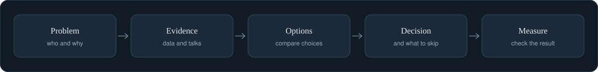

[Back to profile](https://github.com/denisans)



*About 6 min read*

## Overview

Every piece of work starts from the user and business problem, not the solution. I frame the problem, size the opportunity, and decide what to build, and just as importantly what not to build.



## On this page

- [What product thinking is](#what-product-thinking-is)
- [Outputs and outcomes](#outputs-and-outcomes)
- [The three lenses](#the-three-lenses)
- [A framework I use](#a-framework-i-use)
- [Worked example (illustrative)](#worked-example-illustrative)
- [Templates you can copy](#templates-you-can-copy)
- [Common mistakes](#common-mistakes)
- [How it shows up in my work](#how-it-shows-up-in-my-work)
- [Sources](#sources)

## In short

**Start from the problem.** A clear problem statement comes first, written so that users, stakeholders, and the team all recognize it.

**Size the opportunity.** I estimate who is affected, how often, and what it costs to leave it unsolved.

**Decide what not to build.** Saying no early protects the team's focus and keeps the product simple.

**Define success.** Each decision carries a measure, so the team can tell whether it worked.

## What product thinking is

Product thinking is the habit of asking three questions before anyone opens a design tool or writes a line of code:

1. **Which problem** are we solving, and for whom?
2. **Why now**, and what does it cost to leave it unsolved?
3. **How will we know** it worked?

Most failed projects did not fail in the building. They failed earlier, by solving a problem nobody had, or by solving a real problem in a way nobody could use. Product thinking is the discipline that catches this early, when changing direction is cheap.

## Outputs and outcomes

The most useful distinction in product work is between an *output* and an *outcome*.

- An **output** is something the team produces: a feature, a page, a report, a release.
- An **outcome** is the change that output causes: a customer who now completes a task, or a business result that moves.

The product writer Josh Seiden describes an outcome as a change in human behavior that drives business results. That definition is useful because behavior can be observed and measured, while "feature shipped" cannot tell you whether anyone benefited.

| | Output thinking | Outcome thinking |
|---|---|---|
| Goal | "Launch online check-in" | "More guests finish check-in before arrival" |
| Done when | The feature is released | The behavior changes and stays changed |
| Risk | Built the wrong thing, on time | Slower start, because we first check the problem |
| Question | "Did we deliver?" | "Did it work?" |

Output is not bad, it is how outcomes are created. The mistake is to treat output as the finish line.

## The three lenses

Every idea can be tested against three questions. An idea that fails any one of them is not ready.

- **Desirability.** Do real people want this, and will they change behavior to get it?
- **Feasibility.** Can we build and run it with the people, time, and technology we have?
- **Viability.** Does it work for the business: cost, risk, rules, and strategy?

Teams often over-invest in feasibility because it is the part they control. The other two lenses need evidence from outside the team.

## A framework I use

### Step 1. Frame the problem

Write the problem so that users, stakeholders, and the team all recognize it. The test: could a user read it and say "yes, that is my problem"?

A simple way to dig below a first answer is the **5 Whys**: ask "why?" repeatedly until you reach a cause you can act on.

### Step 2. Size the opportunity

Estimate who is affected, how often, and what it costs when the problem occurs. Rough numbers are enough. The goal is to compare problems, not to publish a forecast.

### Step 3. Generate options, including "do nothing"

List at least three ways to respond, and always include doing nothing or doing something very small. It keeps the comparison honest.

### Step 4. Decide, and write down what you will *not* do

A product is defined as much by what it leaves out. Record the items you are deliberately not building and the reason, so the question does not come back every month.

### Step 5. Define success before you build

Pick one or two measures and a target date for checking them. Decide now what result would make you stop or change direction.

## Worked example (illustrative)

*This example is invented to show the method. The numbers are not real.*

**The first statement:** "Guests are not booking rooms on our website."

**5 Whys:**
1. Why not booking? Many guests leave during checkout.
2. Why leave? They reach the payment step and stop.
3. Why stop? The final price is higher than the price they saw in search.
4. Why higher? Tax and service charge are shown only at the end.
5. Why only at the end? The search page was built to show the base room rate.

**Reframed problem:** Guests who search for a room see a price that differs from the final price, and many abandon the booking when they see the difference.

**Options:**

| Option | Benefit | Cost or risk |
|---|---|---|
| Do nothing | No effort | Abandonment continues |
| Show the total price in search results | Removes the surprise | Changes the search page and the price logic |
| Show a "taxes and fees" line earlier in checkout | Small change | May only soften the surprise |

**Decision:** show the total price in search. **Not now:** loyalty discounts, because they do not address the cause.

**Success measure:** the share of guests who reach checkout and complete the booking, compared before and after, checked four weeks after release.

## Templates you can copy

**Problem statement**

```text
[Who] struggles to [do what] because [cause].
This matters because [consequence for the user or the business].
We will know it is solved when [observable change].
```

**Decision log entry**

```text
Date:
Decision:
Options considered:
Why this one:
What we are not doing:
Measure and check date:
Owner:
```

## Common mistakes

- **Starting from the solution.** "We need a dashboard" is a solution. Ask what decision the dashboard would help someone make.
- **Asking people what they would do.** Opinions about the future are weak evidence. Past behavior is stronger.
- **Counting features shipped.** It measures activity, not benefit.
- **Never writing down the "no".** Without a record, rejected ideas return again and again.
- **Measuring too many things.** One or two measures that the team actually watches beat ten that nobody does.

## How it shows up in my work

On this profile, **Crownsky** is the clearest example of a product with a user problem at its centre: guests need to find and book a room, and staff need to manage rooms and reports. The way I read any project like it is to start from those user tasks before looking at the code.

## What it produces

- A problem statement and goals
- A prioritized list of what to build now, next, and later
- A short decision log with the reasons behind each choice

## Where it shows up

- [Crownsky](https://github.com/denisans/denisans/blob/main/details/crownsky.md)

## Sources

- [Outcomes vs. outputs, with examples (Product Talk)](https://www.producttalk.org/outcomes-vs-outputs/)
- [Talking to customers without being misled, a primer on The Mom Test](https://www.sachinrekhi.com/the-mom-test-rob-fitzpatrick)
- [Choosing user-centered metrics with the HEART framework](https://www.productcompass.pm/p/the-google-heart-framework)

---

[Back to profile](https://github.com/denisans)
