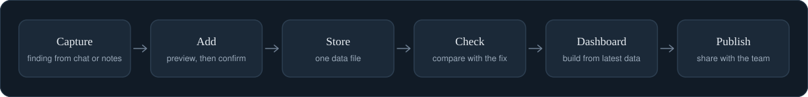
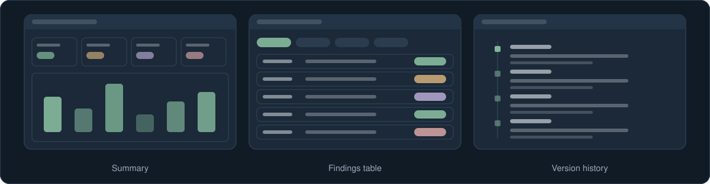

[Back to profile](https://github.com/denisans)

**Repository:** [denisans/qa-tracker](https://github.com/denisans/qa-tracker) &nbsp;|&nbsp; **Stack:** HTML, Python

## Overview

qa-tracker keeps QA findings in one data file and turns them into a dashboard the whole team can read. A Python tool adds, updates, and checks findings, and every change is previewed before it is written. A GitHub Actions workflow validates the data and rebuilds the dashboard on every push. The findings themselves are not shown on this page.

## From finding to dashboard

How a QA finding moves through the tracker.

## Screens

Simplified sketches of the main screens.

## What is inside

| Part | What it does | Where |
|---|---|---|
| **Data** | The single source of truth for all findings, with a change history | `data/qa.json` |
| **Command-line tool** | validate, summary, list, add, update, apply-check, dashboard, export-csv, versions | `scripts/qa.py` |
| **Dashboard** | The page built from the latest data, with numbered backups of each version | `dashboard/` |
| **Automatic checks** | Validates the data and builds the dashboard on every push or pull request | `.github/workflows/validate.yml` |
| **Assistant commands** | Shortcuts for adding, checking, syncing, publishing, and summarizing | `/qa-add`, `/qa-check`, `/qa-sync`, `/qa-publish`, `/qa-summary`, `/qa-ui` |

## How it works

- One data file is the only place findings live, so every view stays consistent.
- Nothing is written until the change has been previewed and confirmed.
- Fixes are checked against the code, and the result is recorded next to the finding; whether a finding is closed is decided by QA after a retest.

## Technology

- Python for the command-line tool
- HTML for the dashboard
- GitHub Actions for automatic validation
- JSON for the data

## Status and next steps

**Status:** In active use as a working tool.

- Add a short guide that explains the workflow to new team members.
- Keep real project data out of the public repository.

---

[Back to profile](https://github.com/denisans) &nbsp;|&nbsp; [Open the repository](https://github.com/denisans/qa-tracker)
