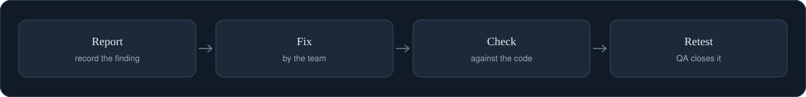

[Back to profile](https://github.com/denisans)



*About 6 min read*

## Overview

Keeping quality visible and keeping people aligned, so that issues are found, fixed, and confirmed with everyone informed.



## On this page

- [Two skills that depend on each other](#two-skills-that-depend-on-each-other)
- [Part 1. The QA workflow](#part-1-the-qa-workflow)
- [Part 2. Stakeholder alignment](#part-2-stakeholder-alignment)
- [Common mistakes](#common-mistakes)
- [How it shows up in my work](#how-it-shows-up-in-my-work)
- [Sources](#sources)

## In short

**QA workflow.** Findings are recorded once, checked against the fix, and closed by QA after a retest. The qa-tracker project supports this.

**Stakeholder alignment.** Regular updates and clear ownership keep stakeholders and the delivery team on the same page.

## Two skills that depend on each other

Quality work is mostly **communication work**. A defect is only useful once it is described clearly, reaches the right person, is fixed, is confirmed, and everyone who cares knows the result. Each of those hand-offs is a place where things get lost. This page covers a QA workflow that keeps things from getting lost, and the stakeholder habits that keep people aligned around it.

## Part 1. The QA workflow

### One list, one owner for each decision

Findings are recorded **once**, in **one list**. Every finding then moves through a small set of statuses, and each move has a clear owner.

```text
New  ->  In progress  ->  Ready for retest  ->  Closed
                               |
                               +--> Reopened (back to In progress)
```

| Status | Who moves it here | What it means |
|---|---|---|
| New | QA or anyone reporting | Recorded, not yet picked up |
| In progress | Developer | Someone is working on it |
| Ready for retest | Developer | The developer says it is fixed |
| Closed | **QA, after retesting** | The fix is confirmed |
| Reopened | QA | The retest failed |

The most important rule: **the person who fixes a defect does not close it.** QA closes it after a retest. A developer saying "fixed" is a claim; a retest is evidence.

### Severity and priority are different

| | Severity | Priority |
|---|---|---|
| Question | How badly does it affect the product? | How soon should we fix it? |
| Usually set by | QA, when logging | Product owner or manager, at triage |
| Based on | Technical and user impact | Business context, deadlines, visibility |

They can disagree. A wrong company name on the home page is low severity but may be high priority. Record both.

A common four-level severity scale:

| Level | Meaning | Example |
|---|---|---|
| Critical | Blocks a core task for many users, or loses data | Payment fails for every guest |
| High | A core task is broken for some users | Checkout button does nothing on mobile |
| Medium | A task works but badly, or has a workaround | A filter resets after each page |
| Low | Cosmetic or minor | A misaligned label |

### Triage

**Triage** is a short, regular meeting in which new findings are validated, given a severity and a priority, assigned an owner, and scheduled or explicitly closed. Bring only what is ready. Defects that arrive already reproduced, with steps and evidence, take a fraction of the time.

### A bug report that gets fixed

```text
Title:      Checkout button does nothing on mobile
Module:     Checkout
Severity:   High
Steps:      1. Open the site on a phone
            2. Add a room to the booking
            3. Tap "Pay"
Expected:   The payment page opens
Actual:     Nothing happens, no error message
Evidence:   Screenshot, device and browser version
Reported:   2026-11-12 by (name)
```

### Verification, step by step

1. The developer marks the finding **Ready for retest** and links the change that fixes it.
2. QA repeats the *same steps* on the fixed version.
3. If the result matches the expected behavior, QA records the result and **closes** it.
4. If not, QA **reopens** it with what was seen.

An extra check that I find valuable: someone reads the fix in the code to see whether it matches the finding. It does not replace the retest; it catches cases where a status says "fixed" but the change is missing.

### A release-risk summary

Before a release, the PM and QA need one short answer: *is it safe to ship?* A summary that fits on one screen:

```text
Open Critical:   0
Open High:       2   (listed below)
Ready for retest: 5
Reopened since last release: 1
Verdict:  Ship after the two High items are retested
```

Numbers support a decision; they do not replace one. Always add one sentence with the recommendation.

## Part 2. Stakeholder alignment

### Who needs what

| Stakeholder | What they care about | What to give them |
|---|---|---|
| Sponsor or manager | Can we release? What is blocking? | The risk summary, one page |
| Developers | What exactly is broken, and how to reproduce it | Clear reports, quick triage decisions |
| QA | What is ready to test | A visible queue and stable test environments |
| Customer or user representative | Whether their problem is solved | Demos and plain-language release notes |

### Habits that keep people aligned

- **Say the same thing to everyone.** One status, one source of truth.
- **Raise bad news early**, with options. An early amber is always better than a late red.
- **Write decisions down** and tell the people they affect.
- **Keep a visible list of known issues** at release time. Honest limits build trust.
- **Thank the finders.** Reporting a defect should feel safe, not like an accusation.

## Common mistakes

- **The fixer closes their own bug.**
- **One field for both severity and priority.**
- **Vague reports** ("it does not work") that need three follow-up questions.
- **Findings spread across chat threads**, so no single list is trusted.
- **Reporting a number with no recommendation.**
- **Hiding known issues** until a customer finds them.

## How it shows up in my work

This workflow is what the **qa-tracker** project implements. It keeps all findings in one data file, with severity and priority as separate fields. Changes pass through a command-line tool that shows a preview first and checks every record. The Closed status is set by QA after a retest and not by the developer or the tool. A built-in summary reports the numbers for release risk, and a dashboard shows the list. Automatic validation runs on every push to the repository.

## What it produces

- A single list of QA findings
- A summary of status and release risk
- Stakeholder updates

## Where it shows up

- [qa-tracker](https://github.com/denisans/denisans/blob/main/details/qa-tracker.md)

## Sources

- [Bug severity versus priority, with examples (Plane)](https://plane.so/blog/bug-severity-vs-priority-in-testing-key-differences)
- [What defect triage is and how to run it](https://bug0.com/knowledge-base/defect-triage)
- [RACI for clear ownership (Mind Tools)](https://www.mindtools.com/agn584l/the-raci-matrix)

---

[Back to profile](https://github.com/denisans)
