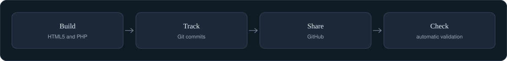

[Back to profile](https://github.com/denisans)



*About 7 min read*

## Overview

The tools I use to build small projects and to work with engineers from a product point of view.



## On this page

- [Why a product person learns these tools](#why-a-product-person-learns-these-tools)
- [HTML5: the structure of a web page](#html5-the-structure-of-a-web-page)
- [PHP: the server side of a website](#php-the-server-side-of-a-website)
- [Git: a time machine for your work](#git-a-time-machine-for-your-work)
- [GitHub: where the team meets the code](#github-where-the-team-meets-the-code)
- [How the tools fit together](#how-the-tools-fit-together)
- [Common mistakes](#common-mistakes)
- [Where the tools show up in my work](#where-the-tools-show-up-in-my-work)
- [Sources](#sources)

## In short

**HTML5.** Used for the qa-tracker dashboard and for web pages.

**PHP.** Used in Crownsky, a hotel booking website.

**Git and GitHub.** Version control and collaboration for every project on this profile.

## Why a product person learns these tools

I do not need to be the fastest developer in the room. I need to **understand the tools well enough to ask good questions, read what the team ships, and build small things myself**. These tools, HTML5, PHP, Git, and GitHub, are the ones I use for that on this profile. For each one this page shows what it is for, a small example, and what to look for when reviewing someone else's work.

## HTML5: the structure of a web page

HTML describes what is *on* a page; CSS describes how it looks; JavaScript describes what it does. HTML5 added meaningful, "semantic" tags so that a page's structure can be understood by browsers, search engines, and screen readers.

### Example

```html
<main>
  <h1>Weekly bookings</h1>
  <section aria-labeledby="monday">
    <h2 id="monday">Monday</h2>
    <table>
      <caption>Bookings for Monday</caption>
      <thead>
        <tr><th scope="col">Guest</th><th scope="col">Room</th></tr>
      </thead>
      <tbody>
        <tr><td>A. Santoso</td><td>Deluxe</td></tr>
      </tbody>
    </table>
  </section>
</main>
```

**Reading it.** `main` marks the main content of the page. `h1` and `h2` form a heading outline that assistive software uses to navigate. `section` groups related content, and `aria-labeledby` ties the section to its heading. `caption`, `thead`, and `th scope="col"` tell a screen reader what each cell means.

**What to look for in review**

- One `h1` per page, and headings in order.
- Buttons are real `button` elements and links are real `a` elements.
- Every image has a text alternative (`alt`).
- Form fields have a visible `label`.

I use HTML5 for the **qa-tracker** dashboard and for the page you are reading.

## PHP: the server side of a website

PHP runs on the web server and produces the page. It talks to databases, handles sign-in and forms, and decides what each user may see. The **Crownsky** hotel booking website is written in PHP with a MySQL database.

### Example: find free rooms safely

The most important habit in server code is to **never paste user input into a database query**. Pass it as a parameter. Here is a small, runnable example that finds rooms that are free for a date range:

**File: `search_rooms.php`**

```php
<?php
// Find rooms that are free for a date range. The values go in as parameters,
// never glued into the SQL text, so user input cannot change the query.
function find_free_rooms(PDO $db, string $checkIn, string $checkOut): array {
    $sql = "SELECT r.id, r.name, r.price
            FROM rooms r
            WHERE r.id NOT IN (
                SELECT b.room_id FROM bookings b
                WHERE b.check_in < :check_out AND b.check_out > :check_in
            )
            ORDER BY r.price";
    $stmt = $db->prepare($sql);
    $stmt->execute([':check_in' => $checkIn, ':check_out' => $checkOut]);
    return $stmt->fetchAll(PDO::FETCH_ASSOC);
}

// Tiny demo with an in-memory database.
$db = new PDO('sqlite::memory:');
$db->exec("CREATE TABLE rooms (id INTEGER PRIMARY KEY, name TEXT, price INTEGER)");
$db->exec("CREATE TABLE bookings (room_id INTEGER, check_in TEXT, check_out TEXT)");
$db->exec("INSERT INTO rooms VALUES (1,'Garden room',450000),(2,'Deluxe',650000),(3,'Suite',900000)");
$db->exec("INSERT INTO bookings VALUES (2,'2026-12-24','2026-12-27')");

foreach (find_free_rooms($db, '2026-12-25', '2026-12-26') as $room) {
    echo $room['name'], ' - ', number_format($room['price']), "\n";
}
```

**Reading it.**

- `function find_free_rooms(PDO $db, string $checkIn, string $checkOut): array` declares a function that receives a database connection and two dates, and returns a list.
- The text inside `$sql` is the query. The words `:check_in` and `:check_out` are **placeholders**. The real values never become part of the query text.
- The subquery in the middle finds bookings that overlap the requested dates: a booking overlaps when it starts before the requested check-out and ends after the requested check-in. Rooms in that set are excluded with `NOT IN`.
- `$db->prepare($sql)` sends the query shape to the database first. `$stmt->execute([...])` then supplies the values separately. This is called a **prepared statement**, and it is what prevents SQL injection.
- The demo at the bottom uses a throwaway in-memory database with three rooms and one booking, so it can run anywhere.

**What it prints**

```text
Garden room - 450,000
Suite - 900,000
```

The Deluxe room is missing from the result because it is booked from the 24th to the 27th, which overlaps the 25th to the 26th.

**What to look for in review**

- Queries use prepared statements with placeholders.
- Passwords are stored as hashes, never as plain text.
- Output is escaped before it is shown (`htmlspecialchars`), to stop injected scripts.
- Secrets such as database passwords are not stored in the repository.
- Errors are logged, not displayed to visitors.

## Git: a time machine for your work

Git records the history of a project as a series of **commits**. Each commit is a saved snapshot with a message. It makes three things possible: seeing what changed, working on a change without disturbing the main version, and returning to any earlier point.

### The commands I use most

| Command | What it does |
|---|---|
| `git status` | Shows what has changed |
| `git add file` | Selects a change for the next snapshot |
| `git commit -m "feat: add weekly bookings page"` | Saves the snapshot with a message |
| `git switch -c my-change` | Starts a new branch to work in safely |
| `git push` | Sends your commits to GitHub |
| `git log --oneline` | Lists the history in short form |
| `git tag v1.2.0` | Puts a named bookmark on a version |
| `git revert abc123` | Undoes a commit by adding a new, reversing commit |

### Good habits

- **Small commits**, each with one purpose.
- **Messages that explain**, ideally in the Conventional Commits form (`feat:`, `fix:`, `docs:`).
- **Branches** for changes, so that `main` always works.
- **Tags** for versions that you may want to return to.

## GitHub: where the team meets the code

GitHub stores a Git repository online and adds tools for collaboration.

| Feature | What it is for |
|---|---|
| Repository | The home of a project's files and history |
| Issues | A list of tasks, bugs, and ideas, with discussion |
| Pull requests | A proposed change, reviewed before it is merged |
| Actions | Automatic checks and tasks that run on every push |
| Pages | Free hosting for simple websites |
| README | The front page of a repository, which is also what this profile is |

### A review habit for pull requests

1. Read the description: does it say **why** the change is made?
2. Look at the checks: are the automatic tests green?
3. Read the change: is it small enough to understand?
4. Ask one question about what could go wrong, and how it can be undone.

## How the tools fit together

```text
Write (HTML5, PHP)  ->  Save (Git commit)  ->  Share (GitHub push)  ->  Check (Actions)  ->  Review (pull request)
```

## Common mistakes

- **Pasting user input into SQL.**
- **Committing passwords or keys** to a repository. Once pushed, assume they are exposed.
- **Giant commits** with the message "update".
- **Working directly on `main`** with no checks.
- **Using div and span for everything** in HTML, which breaks accessibility.

## Where the tools show up in my work

- **Crownsky:** PHP and MySQL, a hotel booking website with a guest area and an admin area.
- **qa-tracker:** HTML5 for the dashboard, with Git versions, tags, and automatic checks on GitHub.
- **This profile:** Markdown and SVG, kept in a GitHub repository.

## What it produces

- Working web projects
- A versioned history of every change
- Automatic checks on each push

## Where it shows up

- [Crownsky](https://github.com/denisans/denisans/blob/main/details/crownsky.md)
- [qa-tracker](https://github.com/denisans/denisans/blob/main/details/qa-tracker.md)

## Sources

- [Conventional Commits specification](https://www.conventionalcommits.org/en/v1.0.0/)
- [Defining a GitHub Actions workflow](https://carpentries-incubator.github.io/byte-sized-rse-ci/defining-a-workflow.html)
- [pytest basics (Microsoft Learn), for how developers check their own code](https://learn.microsoft.com/en-us/training/modules/test-python-with-pytest/2-pytest-basics)

---

[Back to profile](https://github.com/denisans)
