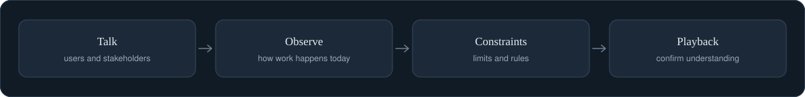

[Back to profile](https://github.com/denisans)



*About 6 min read*

## Overview

Talk to users and stakeholders, gather context, and clarify constraints before proposing anything.



## On this page

- [Why this step comes first](#why-this-step-comes-first)
- [The four activities](#the-four-activities)
- [1. Talk: interviews that produce real evidence](#1-talk-interviews-that-produce-real-evidence)
- [2. Observe: map the current process](#2-observe-map-the-current-process)
- [3. Constraints: the edges of the possible](#3-constraints-the-edges-of-the-possible)
- [4. Play back](#4-play-back)
- [Worked example (illustrative)](#worked-example-illustrative)
- [Output: the discovery pack](#output-the-discovery-pack)
- [Common mistakes](#common-mistakes)
- [How it shows up in my work](#how-it-shows-up-in-my-work)
- [Sources](#sources)

## In short

**Listen first.** Interviews and working sessions with the people who feel the problem.

**Map the context.** Who is involved, what happens today, and where it breaks down.

**Name the constraints.** Time, budget, systems, and rules that shape what is possible.

**Confirm understanding.** I play back what I heard until stakeholders agree it is right.

## Why this step comes first

Every later step, from setting goals to prioritizing to building, rests on how well the problem is understood. A wrong assumption here is the most expensive kind, because every step after it inherits it.

Understanding a problem is not the same as collecting requests. People usually describe a *solution* ("add an export button") rather than the *problem* ("I spend an hour every Friday copying numbers into a report"). The job at this stage is to find the problem underneath the request.

## The four activities

1. **Talk** to the people who feel the problem, and to those who decide.
2. **Observe** how the work is really done today.
3. **Name the constraints** that shape what is possible.
4. **Play back** what you heard until the people involved agree it is right.

## 1. Talk: interviews that produce real evidence

Interviews go wrong in a predictable way. People are polite. If you describe your idea, they will say it sounds good, and you will learn nothing. Rob Fitzpatrick's book *The Mom Test* offers three rules to avoid that.

1. **Talk about their life, not your idea.** Ask about their work, their problems, and what they do today.
2. **Ask about specific past events, not future opinions.** "Tell me about the last time you did this" is stronger than "Would you use this?"
3. **Talk less and listen more.** Silence is a tool, and so is "tell me more about that".

### Questions that work, and questions that do not

| Weak question | Why it fails | Stronger question |
|---|---|---|
| "Would you use an online booking tool?" | Invites a polite guess about the future | "How did you book your last stay? What happened step by step?" |
| "Do you think reports are slow?" | Leading, answer is yes | "Walk me through how you prepared the last weekly report." |
| "What features do you want?" | Moves straight to solutions | "What is the hardest part of your week?" |
| "Is this a big problem?" | Vague | "What did it cost you the last time it happened?" |

### Interview structure (30 to 45 minutes)

```text
1. Context (5 min)      Role, a typical week, who they work with
2. A recent example     "Tell me about the last time you ..."
3. The workaround       What do they do today? What did they try?
4. The impact           Time, money, stress, risk
5. Close                "Who else should I talk to?"
```

Write up the notes within a day. Memory fades quickly, and the exact words people used are the most valuable part.

## 2. Observe: map the current process

What people *say* they do and what they *actually* do often differ. Where possible, watch the work happen, or ask the person to walk through it while sharing their screen.

Draw the current process as a simple flow of steps. For each step note **who** does it, **what tool** is used, **how long** it takes, and **where it goes wrong**. Pain points tend to cluster at handovers, duplicate data entry, and waiting for approval.

```text
Request arrives (email)  ->  Copied into a sheet  ->  Checked by hand
        |                         |                       |
   wait: 1 day            error: typos here        wait: until Friday
```

## 3. Constraints: the edges of the possible

A solution that ignores the constraints is only a wish. Collect them early.

| Type | Questions to ask |
|---|---|
| Time | Is there a fixed date? What is it tied to? |
| Money | Is there a budget, and who approves spending? |
| People | Who is available, and for how much of their time? |
| Systems | What must we connect to or avoid replacing? |
| Rules | Are there legal, security, or company policies? |

Also write down **open questions**, the things you do not yet know. A visible list of unknowns is a sign of good work, not weakness.

## 4. Play back

Before moving on, summarize what you learned in a few sentences and read it back to the people involved:

> "What I heard is that [problem], which affects [who], and costs [what]. The main limits are [constraints]. Have I got this right?"

Corrections at this stage cost minutes. After the solution is built they cost weeks.

## Worked example (illustrative)

*Invented for teaching; no real data.*

**Request received:** "Please add a way to export the findings list to Excel."

**What the interviews revealed:**
- The requester exports the list every Thursday to build a status slide for the Friday meeting.
- It takes about 45 minutes, because the columns need cleaning and the statuses are counted by hand.
- The real audience for the slide is a manager who only wants to know: *what is blocking the release?*

**Problem understood:** The weekly status takes 45 minutes of manual work and answers a question the manager could get directly if the release risk were visible.

**Insight:** An export button would help, but a one-page summary of open findings by severity might remove the need for the export altogether. Both go into the options for the next step.

## Output: the discovery pack

By the end of this step you should have, in writing:

- Interview and observation notes
- A map of the current process, with pain points marked
- A list of constraints and open questions
- A one-paragraph statement of the problem that the people involved have confirmed

## Common mistakes

- **Pitching during the interview.** The moment you describe your idea, the data gets polluted.
- **Talking only to one group.** Users, buyers, and decision makers each see a different part of the problem.
- **Treating requests as requirements.** A request is a starting point for a conversation.
- **Skipping the playback.** Misunderstandings that are not caught here are built into the product.
- **Collecting forever.** Stop when new interviews stop changing the picture.

## How it shows up in my work

Reading a project from the user's side is how I approach every repository on this profile. For **Crownsky**, the questions are about guests and hotel staff: how a guest searches and books, and how an administrator manages rooms and reports. For **qa-tracker**, they are about testers and developers: how findings are recorded, fixed, and retested.

## What it produces

- Interview and meeting notes
- A map of the current process
- A list of constraints and open questions

## Sources

- [A primer on The Mom Test (Sachin Rekhi)](https://www.sachinrekhi.com/the-mom-test-rob-fitzpatrick)
- [The Mom Test's three rules, with example questions](https://usercall.co/post/the-mom-test-customer-interview-questions)
- [Business requirements and how they differ from product requirements](https://plane.so/blog/brd-vs-prd-whats-the-difference-and-when-should-teams-use-each)

---

[Back to profile](https://github.com/denisans)
